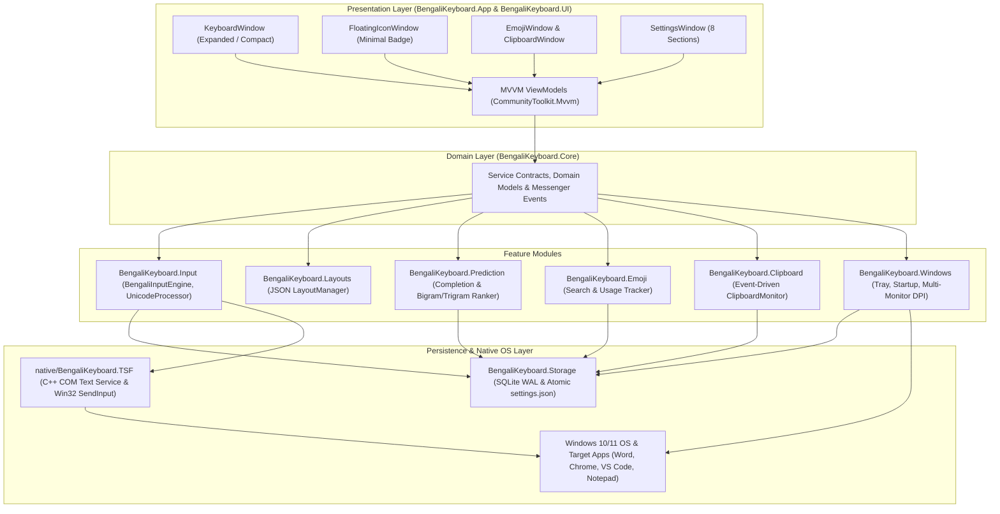

<div align="center">

# ⌨️ BornoKey (বর্ণকী)
### Ridmik-Style Bengali Virtual & Physical Keyboard for Windows 10 / 11

[](#)
[](#)
[](#)
[](#)
[](#)
[](LICENSE)

**Bring the familiar Android Ridmik Keyboard experience to the Windows desktop.**  
A lightweight, offline-first, system-wide Bengali Unicode virtual and physical keyboard featuring real-time word completion, next-word n-gram prediction, an emoji keyboard with usage tracking, and a built-in privacy-first clipboard manager.

[Features](#-key-features) •
[Visual Preview](#-keyboard-preview--window-modes) •
[Architecture](#-system-architecture--tech-stack) •
[Getting Started](#-getting-started) •
[Documentation](#-project-documentation--security-specs) •
[Roadmap](#-development-roadmap) •
[Contributing](#-contributing)

</div>

---

## 🌟 Overview & Motivation

Millions of Bengali speakers type effortlessly every day on Android smartphones using the **Ridmik Keyboard** layout, yet face a steep barrier when switching to a Windows PC—where they must either memorize traditional desktop layouts or rely on Romanized phonetic transliteration.

**BornoKey** bridges that gap by delivering a **native, system-wide Windows desktop keyboard** that reproduces the familiar Ridmik character arrangement, dark tactile keycaps, and intelligent suggestion bar directly on Windows 10 and Windows 11.

Unlike web wrappers or UI-only demos, BornoKey is engineered with **C# / .NET 10 (WPF)** and **Windows Text Services Framework (TSF) / Win32 Interop** so every click on the floating virtual keyboard—or press on your physical keyboard—types directly into Microsoft Word, Google Chrome, Edge, Firefox, Notepad, VS Code, or any active Windows application without ever stealing window focus.

---

## ✨ Key Features

| Module | Capabilities |
|---|---|
| **🇧🇩 Authentic Ridmik-Style Layout** | Direct Bengali Unicode character typing (not Romanized phonetic transliteration). Includes a dedicated top number row (`১–০`), Primary & Shift Bengali layers, Bengali/English symbol panels, full English QWERTY, and JSON-driven layout definitions. |
| **⚡ System-Wide Input Engine** | Dual-channel input engine supporting both **On-Screen Virtual Keys** (`WS_EX_NOACTIVATE` focus-preserving window) and **Physical Keyboard routing** via Windows Text Services Framework (TSF) and `SendInput` (`KEYEVENTF_UNICODE`). Full support for vowels, consonants, *kars* (vowel signs), *hasanta* (`্`), and *juktakkhor* (conjuncts). |
| **🔄 Instant `[ বাংলা ]` ↔ `[ ENG ]` Toggle** | One-click on-screen language pill switch and user-configurable global keyboard shortcut to toggle between Bengali and English immediately. |
| **🧠 Offline Smart Predictive Text** | **1. Real-Time Word Completion:** Prefix trie + SQLite unigram lookup returns 3–5 completions in `≤ 50 ms` (e.g., `আমা` → `আমার`, `আমাকে`, `আমাদের`, `আমায়`).<br>**2. Context-Aware Next-Word Prediction:** Offline Unigram + Bigram + Trigram language model suggests the next likely word after every completed word. |
| **😀 Emoji Keyboard & Usage History** | Built-in emoji panel with **10 categories**, instant keyword & alias search (`smile`, `heart`, `food`), skin-tone/ZWJ multi-codepoint support, and persistent SQLite-backed **Frequently Used** emoji ranking. |
| **📋 Privacy-First Clipboard Manager** | Event-driven Windows clipboard listener (`AddClipboardFormatListener` / `WM_CLIPBOARDUPDATE`—zero polling). Search clips, pin important snippets (`📌`), paste with one click, configure retention limits, and automatically ignore password-manager clips. |
| **🪟 4-Mode Adaptive Floating Window** | Smoothly switch between **Expanded Mode**, **Compact Mode**, **Minimal Floating Icon Mode** (draggable `[ বাংলা ]` badge), and **System Tray Hidden Mode**. Supports free dragging, proportional vector scaling, Always-on-Top, and multi-monitor DPI-aware position restoration across Windows restarts. |
| **🛡️ 100% Offline & Privacy-First** | Zero internet permissions, zero cloud AI APIs, zero telemetry, and zero keystroke logging. All dictionaries, emoji usage, and clipboard history stay strictly local in `%LOCALAPPDATA%\BengaliKeyboard\`. |

---

## 🖥️ Keyboard Preview & Window Modes

### Mode A: Expanded Floating Keyboard (`850 × 310 px` Default — Resizable)

```text
┌──────────────────────────────────────────────────────────────────────────────┐
│ [≡ Drag] BornoKey    [ বাংলা | ENG ]    [😀] [📋] [⚙]   [Compact] [▬] [✕] │ ← Header Toolbar
├──────────────────────────────────────────────────────────────────────────────┤
│   [ আমার ]        │        [ আমাকে ]        │       [ আমাদের ]      │ [ আমায় ] │ ← Smart Suggestion Bar
├──────────────────────────────────────────────────────────────────────────────┤
│  [১]   [২]   [৩]   [৪]   [৫]   [৬]   [৭]   [৮]   [৯]   [০]                  │ ← Dedicated Number Row
│  [ঙ]   [য]   [ড]   [প]   [ট]   [চ]   [জ]   [হ]   [গ]   [ড়]                 │ ← Bangla Row 1
│  [্র]  [া]   [ি]   [ু]   [র]   [ক]   [ত]   [দ]   [স]   [ব]                  │ ← Bangla Row 2
│  [⇧ Shift]  [ো]   [ে]   [্]   [অ]   [ম]   [ন]   [ল]   [শ]   [⌫ Backspace]  │ ← Bangla Row 3
│  [?123] [😀] [🌐 বাংলা/ENG]  [       বাংলা (Space)       ]  [।]  [⏎ Enter]   │ ← Action & Mode Row
└──────────────────────────────────────────────────────────────────────────────┘
```

### Presentation Modes Summary
- **Mode A — Expanded Floating Keyboard:** Full virtual keyboard with suggestion bar, number row, and header controls.
- **Mode B — Compact Floating Keyboard:** Space-saving `620 × 230 px` footprint with crisp Bengali glyph legibility.
- **Mode C — Minimal Floating Icon:** Shrinks into a draggable `[ বাংলা ]` floating badge anywhere on screen; click once to restore.
- **Mode D — System Tray Hidden Mode:** Runs quietly in the Windows Notification Area (`< 1%` idle CPU) with full right-click context menu and auto-startup support.

---

## 🏗️ System Architecture & Tech Stack



### Technology Stack

| Component | Technology | Purpose |
|---|---|---|
| **Primary Language** | C# 13 & C++20 | Managed application modules and native COM TSF text service |
| **Runtime & UI** | `.NET 10.0-windows` + **WPF** | Hardware-accelerated floating windows, vector scaling, custom templates |
| **MVVM & Messaging** | `CommunityToolkit.Mvvm` | Source-generated `ObservableObject`, `RelayCommand`, `WeakReferenceMessenger` |
| **Dependency Injection** | `Microsoft.Extensions.DependencyInjection` | Modular service registration and constructor injection |
| **System Input** | **Windows TSF** + **Win32 `SendInput`** | System-wide Bengali composition, caret tracking, and focus-safe Unicode injection |
| **Local Database** | `Microsoft.Data.Sqlite` (SQLite WAL) | Offline dictionary, n-gram models, emoji history, and DPAPI-protected clipboard store |
| **Configuration** | `System.Text.Json` | Configurable keyboard layouts (`Definitions/**/*.json`) and atomic `settings.json` |
| **Logging** | `Serilog` (`Serilog.Sinks.File`) | Privacy-redacted rolling operational diagnostics |
| **Testing** | `xUnit` | Automated unit & integration tests across Unicode, layouts, prediction, and storage |
| **Installer** | Inno Setup (`BornoKeySetup.iss`) | Standalone Windows installer with startup & TSF registration |

---

## 📂 Repository Structure

```text
BornoKey/
├── docs/                                   # Engineering Specifications & Project Memory
│   ├── PRD.md                              # Product Requirements Document
│   ├── Architecture.md                     # System Architecture, Flows & SQLite Schemas
│   ├── Rules.md                            # Engineering Rules, Libraries & AI Boundaries
│   ├── Phases.md                           # 10-Phase Implementation Roadmap
│   ├── Design.md                           # UI/UX Design System, Color Tokens & Typography
│   └── Memory.md                           # Live Progress & File Completion Tracker
│
├── security/                               # Security & Threat Modeling Documentation
│   ├── threat-model.md                     # STRIDE Threat Model, Assets & Trust Boundaries
│   ├── secrets.md                          # Secrets Handling, DPAPI Encryption & Redaction
│   ├── attack-surface.md                   # Local IPC, OS Hooks, File & DB Attack Surface
│   └── security-checklist.md               # 20-Domain Security Checklist & Findings Ledger
│
├── src/                                    # .NET 10 Managed Source Projects
│   ├── BengaliKeyboard.App/                # Entry Point, Mutex, DI Bootstrapper
│   ├── BengaliKeyboard.Core/               # Shared Interfaces, Models, Enums & Events
│   ├── BengaliKeyboard.UI/                 # WPF Windows, Controls, Themes & ViewModels
│   ├── BengaliKeyboard.Layouts/            # JSON Layout Loader & Bangla/English Definitions
│   ├── BengaliKeyboard.Input/              # BengaliInputEngine, UnicodeProcessor, SendInput
│   ├── BengaliKeyboard.Prediction/         # WordCompletion, Bigram/Trigram Model & Ranker
│   ├── BengaliKeyboard.Emoji/              # Offline Emoji Search & Usage Frequency Service
│   ├── BengaliKeyboard.Clipboard/          # Event-Driven ClipboardMonitor & History Service
│   ├── BengaliKeyboard.Windows/            # SystemTray, Startup, Hotkeys & Multi-Monitor DPI
│   ├── BengaliKeyboard.Storage/            # SQLite Connection Factory & Atomic JSON Config
│   └── BengaliKeyboard.Tests/              # xUnit Automated Test Suite
│
├── native/
│   └── BengaliKeyboard.TSF/                # Native C++20 Windows Text Services Framework DLL
│
├── assets/                                 # Icons (.ico) & Noto Sans Bengali Fonts (.ttf)
├── data/                                   # Offline Bengali Dictionary, N-Grams & Emoji Seeds
├── installer/                              # Inno Setup Script (BornoKeySetup.iss)
└── README.md
```

---

## 📚 Project Documentation & Security Specs

Before contributing or building modules, review our complete architecture and security documentation:

### Engineering Specifications (`docs/`)
- 📄 **[Product Requirements Document (`docs/PRD.md`)](./docs/PRD.md)** — Vision, target personas, functional modules, performance targets, and Definition of Done.
- 🏛️ **[System Architecture (`docs/Architecture.md`)](./docs/Architecture.md)** — Component flows, sequence diagrams, window state machine, `WS_EX_NOACTIVATE` interop, and SQLite schemas.
- 📏 **[Engineering Rules (`docs/Rules.md`)](./docs/Rules.md)** — Approved libraries, prohibited anti-patterns, 10-scenario resilience matrix, and AI coding boundaries.
- 🗺️ **[Phased Roadmap (`docs/Phases.md`)](./docs/Phases.md)** — Step-by-step breakdown of Phases 1 through 10 with deliverables and verification criteria.
- 🎨 **[UI/UX Design System (`docs/Design.md`)](./docs/Design.md)** — Dark/Light semantic color tokens, `Noto Sans Bengali` typography scale, and keycap geometry.
- 🧠 **[Project Memory (`docs/Memory.md`)](./docs/Memory.md)** — Live tracker of completed files, active tasks, and architectural decisions.

### Security Documentation (`security/`)
- 🛡️ **[Threat Model (`security/threat-model.md`)](./security/threat-model.md)** — Assets, trust boundaries, actors, entry points, and STRIDE threat analysis.
- 🔐 **[Secrets & Cryptography (`security/secrets.md`)](./security/secrets.md)** — DPAPI local encryption, keyed HMAC deduplication, and Serilog redaction policies.
- 🎯 **[Attack Surface (`security/attack-surface.md`)](./security/attack-surface.md)** — Local IPC, COM/TSF boundaries, clipboard ingestion, and JSON/SQLite surfaces.
- ✅ **[Security Checklist (`security/security-checklist.md`)](./security/security-checklist.md)** — 20-domain desktop security checklist and prioritized findings ledger.

---

## 🚀 Getting Started

### Prerequisites
- **OS:** Windows 10 (version 1903+) or Windows 11 (x64 / ARM64)
- **SDK:** [.NET 10.0 SDK](https://dotnet.microsoft.com/download/dotnet/10.0) (with Windows Desktop / WPF workload)
- **Native Build Tools (for TSF DLL):** Visual Studio 2022/2026 with **Desktop development with C++** workload and Windows 10/11 SDK
- **Installer (Optional):** [Inno Setup 6.x](https://jrsoftware.org/isinfo.php)

### Build & Run from Source

```powershell
# 1. Clone the repository
git clone https://github.com/shantopaul/BornoKey.git
cd BornoKey

# 2. Restore NuGet dependencies and build the solution
dotnet restore BengaliKeyboard.sln
dotnet build BengaliKeyboard.sln -c Release

# 3. Run the automated xUnit test suite
dotnet test src/BengaliKeyboard.Tests/BengaliKeyboard.Tests.csproj -c Release

# 4. Launch BornoKey
dotnet run --project src/BengaliKeyboard.App/BengaliKeyboard.App.csproj -c Release
```

### Runtime Data Location
BornoKey runs under standard user privileges (`asInvoker`) and stores all local configuration and databases inside:
```text
%LOCALAPPDATA%\BengaliKeyboard\
├── Config\settings.json
├── Database\keyboard.db
├── Database\dictionary.db
└── Logs\bornokey-YYYYMMDD.log
```

---

## ⚡ Performance & Privacy Commitments

| Metric | Engineering Target |
|---|---|
| **Idle CPU Usage** | `< 1%` (strictly event-driven; zero background polling timers) |
| **Idle Memory (RAM)** | `50 MB – 100 MB` (lazy dictionary and emoji loading) |
| **Typing Latency** | `< 10 ms` (imperceptible keystroke-to-caret insertion) |
| **Offline Prediction Lookup** | `≤ 50 ms` asynchronous candidate query off the UI dispatcher thread |
| **Cold Startup Time** | `< 2.0 seconds` |
| **Network Traffic** | `0 bytes` (100% offline; zero cloud APIs or telemetry) |
| **Clipboard Privacy** | Local DPAPI protection, honours password-manager exclusion formats, zero logging |

---

## 🛣️ Development Roadmap

Development is organized into **10 verified phases** (tracked live in [`docs/Phases.md`](./docs/Phases.md) and [`docs/Memory.md`](./docs/Memory.md)):

- [x] **Phase 0:** Complete SRS, Architecture, Design System, Roadmap & Security Threat Model
- [ ] **Phase 1:** Project Foundation, `.NET 10` Solution, DI Container, Single-Instance Mutex & SQLite/JSON Storage
- [ ] **Phase 2:** Ridmik-Style Keyboard UI, Reusable Key Controls & Configurable JSON Layout Engine
- [ ] **Phase 3:** Bengali Unicode Input Engine, `WS_EX_NOACTIVATE` Interop, Physical Keyboard Routing & TSF Integration
- [ ] **Phase 4:** Adaptive Floating Keyboard, Proportional Scaling & 4 Presentation Modes (`Expanded`, `Compact`, `Minimal Icon`, `Tray`)
- [ ] **Phase 5:** Windows System Tray Integration, Global Hotkeys, Auto-Startup & Multi-Monitor State Restoration
- [ ] **Phase 6:** Offline Emoji Keyboard, 10 Categories, Keyword Search & Persistent Frequently Used History
- [ ] **Phase 7:** Event-Driven Privacy-First Clipboard History Manager (Search, Pin, Paste, Exclusions)
- [ ] **Phase 8:** Smart Offline Bengali Predictive Text Engine (Prefix Word Completion & Bigram/Trigram Next-Word Prediction)
- [ ] **Phase 9:** 8-Tab Settings Window, Dark/Light/System Themes & UI/Performance Polish
- [ ] **Phase 10:** Cross-Application Compatibility Testing, Documentation & Inno Setup Release Installer

---

## 🤝 Contributing

Contributions from the open-source community are warmly welcomed! Whether you are improving Bengali n-gram dictionaries, refining WPF UI templates, enhancing Windows TSF compatibility, or reporting bugs:

1. Read [`docs/Architecture.md`](./docs/Architecture.md) and [`docs/Rules.md`](./docs/Rules.md) to understand our modular MVVM boundaries and privacy guarantees.
2. Fork the repository and create your feature branch (`git checkout -b feat/amazing-feature`).
3. Ensure all existing and new `xUnit` tests pass (`dotnet test`) and zero sensitive user data is logged.
4. Open a Pull Request describing your changes and verification steps.

---

## 📄 License

Distributed under the **MIT License**. See `LICENSE` for full license text.

<div align="center">
  <sub>Built with ❤️ for the Bengali-speaking Windows community.</sub>
</div>
