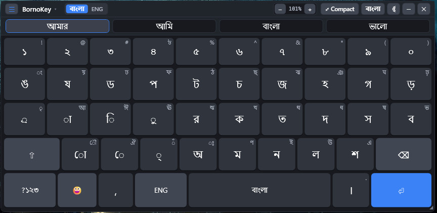
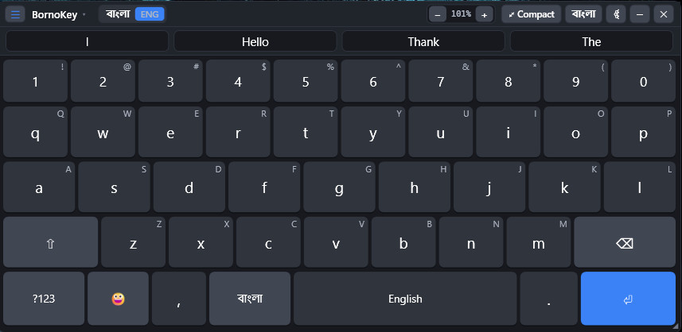
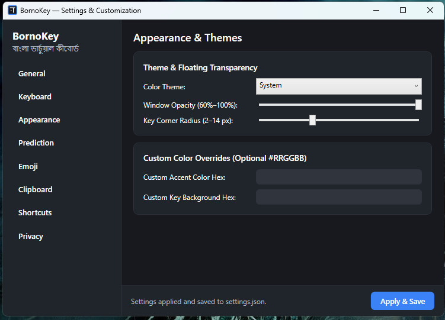
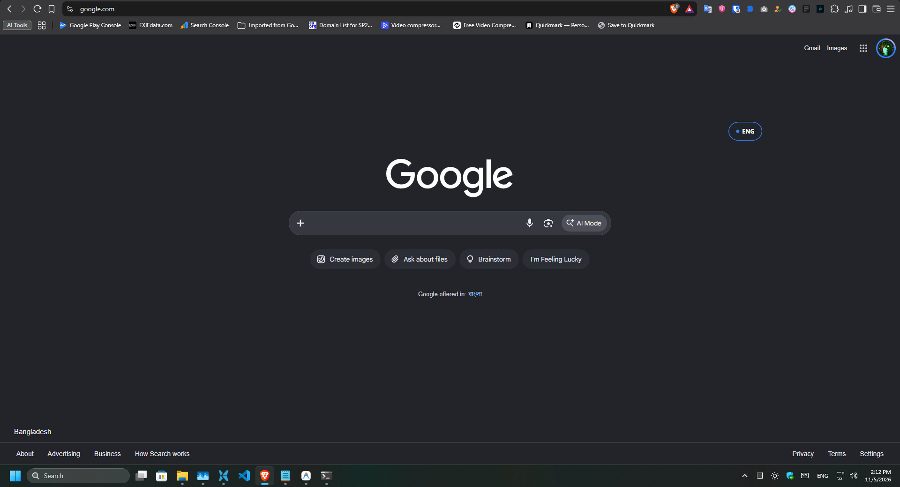
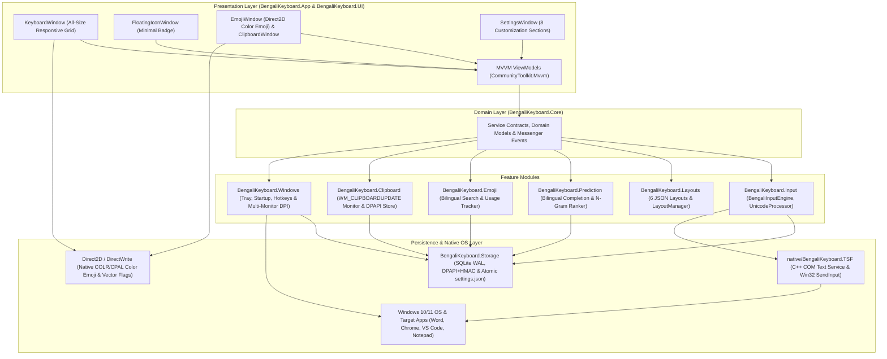

<div align="center">

# ⌨️ BornoKey (বর্ণকী)
### Ridmik-Style Bengali Virtual & Physical Keyboard for Windows 10 / 11

[](#)
[](#)
[](#)
[](#)
[](#)
[](#)
[](LICENSE)

**Bring the familiar Android Ridmik Keyboard experience to the Windows desktop.**  
A lightweight, offline-first, system-wide Bengali (`বাংলা`) and English (`ENG`) Unicode virtual and physical keyboard featuring real-time bilingual word completion, next-word n-gram prediction, a Direct2D full-color emoji keyboard with usage tracking, and a built-in DPAPI-encrypted privacy-first clipboard manager.

[Features](#-key-features) •
[Screenshots](#-screenshots--visual-preview) •
[Shortcuts](#-default-global-keyboard-shortcuts) •
[Architecture](#-system-architecture--tech-stack) •
[Getting Started](#-getting-started) •
[Documentation](#-project-documentation--security-specs) •
[Roadmap](#-development-roadmap) •
[Contributing](#-contributing)

</div>

---

## 🌟 Overview & Motivation

Millions of Bengali speakers type effortlessly every day on Android smartphones using the **Ridmik Keyboard** layout, yet face a steep barrier when switching to a Windows PC—where they must either memorize traditional desktop layouts or rely on Romanized phonetic transliteration.

**BornoKey** bridges that gap by delivering a **native, system-wide Windows desktop keyboard** that reproduces the familiar Ridmik character arrangement, dark tactile keycaps, and intelligent bilingual suggestion bar directly on Windows 10 and Windows 11.

Unlike web wrappers or UI-only demos, BornoKey is engineered with **C# 13 / .NET 10 (WPF)**, **Direct2D / DirectWrite**, and **Windows Text Services Framework (TSF) / Win32 Interop** so every click on the floating virtual keyboard—or press on your physical keyboard—types directly into Microsoft Word, Google Chrome, Edge, Firefox, Notepad, VS Code, or any active Windows application without ever stealing window focus.

---

## ✨ Key Features

| Module | Capabilities |
|---|---|
| **🇧🇩 Authentic Ridmik-Style Layout (6 Layers)** | Direct Bengali Unicode character typing (not Romanized phonetic transliteration). Includes a dedicated top number row (`১–০`), **Bangla Primary**, **Bangla Shift** (aspirated consonants & conjuncts `ক্ষ`, `জ্ঞ`, `ত্র`, `শ্র`), **Bangla Numbers**, **Bangla Symbols** (`৳`, `।`, `॥`), **English QWERTY**, and **English Symbols**—all driven by validated JSON definitions with embedded fallback. |
| **⚡ Focus-Preserving System-Wide Input Engine** | Dual-channel input engine supporting both **On-Screen Virtual Keys** (`WS_EX_NOACTIVATE` + `WM_MOUSEACTIVATE` focus-preserving window) and **Physical Keyboard routing** via native C++ **Windows Text Services Framework (`BengaliKeyboard.TSF.dll`)** and `SendInput` (`KEYEVENTF_UNICODE`). Full support for vowels (`স্বরবর্ণ`), consonants (`ব্যঞ্জনবর্ণ`), vowel signs (`কার`: `া ি ী ু ূ ৃ ে ৈ ো ৌ`), *hasanta* (`্`), *juktakkhor* (`যুক্তাক্ষর`), रेফ (`র্`), র-ফলা (`্র`), য-ফলা (`্য`), and grapheme-aware backspace. |
| **🔄 Instant `[ বাংলা ]` ↔ `[ ENG ]` Toggle & Quick Menu** | One-click on-screen `[ বাংলা \| ENG ]` pill switch, interactive top-left `[ ☰ BornoKey ▾ ]` Quick Menu, and configurable global keyboard shortcuts (`Ctrl + Space` / `Alt + Shift + B`) to switch languages immediately. |
| **🧠 Bilingual Smart Predictive Text (`বাংলা` + `ENG`)** | **1. Real-Time Word Completion (`≤ 50 ms`):** Indexed SQLite `dictionary.db` (`ReadOnly` at runtime) + personalized `UserDictionary` learning returns 3–5 completions for both Bengali (`আমা` → `আমার`, `আমাকে`, `আমাদের`, `আমায়`) and English (`hel` → `hello`, `help`, `helping`).<br>**2. Smart English Contractions & Casing:** Automatically expands apostrophe-less contractions (`dont` → `don't`, `im` → `I'm`, `cant` → `can't`) and chat shorthands (`plz` → `please`, `thx` → `thanks`), deduplicates repeated keys (`hhhh` → `hello`), and preserves `Title Case` / `ALL CAPS`.<br>**3. Context-Aware Next-Word Prediction:** Offline `Trigram` → `Bigram` → `Unigram` backoff model suggests the next likely word in the active language after every space or punctuation mark. |
| **😀 Full-Color Direct2D Emoji Keyboard** | Hardware-accelerated **Direct2D + DirectWrite (`D2D1_DRAW_TEXT_OPTIONS_ENABLE_COLOR_FONT`)** color emoji renderer (`Segoe UI Emoji` COLR/CPAL layers + vector country flags `🇧🇩 🇮🇳 🇺🇸 🇬🇧 🇸🇦 🇵🇸 🇨🇦 🇦🇺 🇯🇵 🇧🇷 🇦🇷`). Features **10 zero-scrollbar category tabs**, instant bilingual keyword search (`smile`, `heart`, `fire`, `হাসি`, `ভালোবাসা`), Popular fallback section, live hover preview bar, and SQLite-backed **Frequently Used** history. |
| **📋 Privacy-First DPAPI Clipboard Manager** | Event-driven Windows clipboard listener (`AddClipboardFormatListener` / `WM_CLIPBOARDUPDATE`—zero polling). Encrypts every clip at rest via **Windows DPAPI (`DataProtectionScope.CurrentUser`)**, deduplicates via keyed `HMACSHA256`, supports instant search & pinning (`📌`), and strictly honors all 4 password-manager exclusion formats (`ExcludeClipboardContentFromMonitorProcessing`, `CanIncludeInClipboardHistory`, `CanUploadToCloudClipboard`, `ClipboardViewerIgnore`). |
| **📐 Distortion-Free All-Size Responsive Window** | Smoothly switch between **Expanded Mode** (`850 × 310 px`), **Compact Mode** (`620 × 230 px`), **Minimal Floating Icon Mode** (draggable `[ বাংলা ]` badge), and **System Tray Hidden Mode**. Supports 8-edge/corner drag-resizing (`440 × 180` up to `1600 × 600`), header `[ − \| 100% \| + ]` step/drag zoom, `Ctrl + MouseWheel` scaling, adaptive narrow breakpoints, and **1:1 uniform glyph aspect-ratio scaling** (zero horizontal or vertical text distortion at any window ratio). |
| **🎨 8-Section Settings & Theme Engine** | Windows 11-inspired 2-pane Settings dialog covering **General, Keyboard, Appearance, Prediction, Emoji, Clipboard, Shortcuts, and Privacy**, with instant runtime switching between **Dark Theme (Ridmik Signature)**, **Light Theme**, and **Windows System Default** (`AppsUseLightTheme`). |
| **🛡️ 100% Offline & Privacy-First** | Zero internet permissions, zero `HttpClient` references, zero cloud AI APIs, zero telemetry, and zero keystroke/clipboard logging. All user data stays strictly local in NTFS-ACL-hardened `%LOCALAPPDATA%\BengaliKeyboard\`. |

---

## 🖼️ Screenshots & Visual Preview

### 1. Authentic Ridmik-Style Bengali Virtual Keyboard (`[ বাংলা ]` Mode)
<div align="center">
  
</div>

> **Direct Bengali Unicode Typing & Smart Suggestion Bar (`01-bangla-ridmik-virtual-keyboard.jpg`):**  
> Displays the signature Ridmik dark-slate keycaps with primary & secondary Shift/Right-click glyphs (`ঙ / ং`, `য / য়`, `্র / ৃ`, `া / আ`, `ি / ই`, `ু / উ`), a dedicated Bengali number row (`১–০`), real-time offline Bengali word completion & next-word predictions (`আমার`, `আমি`, `বাংলা`, `ভালো`), full-color Direct2D emoji trigger (`😀`), and the adaptive top toolbar (`[ ☰ ] BornoKey ▾`, `[ বাংলা | ENG ]`, `[ − | 101% | + ]`, `[⤢ Compact]`, `[বাংলা]`, `[⚙]`).

---

### 2. English QWERTY Virtual Keyboard with Smart Predictive Text (`[ ENG ]` Mode)
<div align="center">
  
</div>

> **Instant English Mode & Predictive Suggestions (`02-english-qwerty-predictive-keyboard.jpg`):**  
> Switching the header pill or pressing `Ctrl + Space` transitions BornoKey to full **English QWERTY (`[ ENG ]`)** with live English starter/completion suggestions (`I`, `Hello`, `Thank`, `The`), automatic apostrophe contraction expansion (`dont` → `don't`, `im` → `I'm`), chat shorthand expansion (`plz` → `please`), and secondary uppercase/symbol hints (`1 / !`, `q / Q`, `a / A`).

---

### 3. 8-Section Settings & Customization Suite (`Appearance & Themes`)
<div align="center">
  
</div>

> **Windows 11-Inspired 2-Pane Settings Dialog (`03-settings-appearance-customization.jpg`):**  
> Provides granular offline configuration across **8 sections** (*General, Keyboard, Appearance, Prediction, Emoji, Clipboard, Shortcuts, Privacy*). Shown above is the **Appearance & Themes** panel featuring runtime **Dark / Light / System** theme switching, floating window opacity (`60%–100%`), key corner radius (`2–14 px`), and custom `#RRGGBB` accent & key background overrides.

---

### 4. Minimal Floating `[ • ENG / বাংলা ]` Pill Badge & System Tray Mode (`Mode C`)
<div align="center">
  
</div>

> **Unobtrusive Floating Desktop Badge (`04-minimal-floating-badge-mode.jpg`):**  
> Clicking the `[বাংলা]` badge button in the keyboard header collapses the full keyboard into a compact, non-activating, draggable **`[ • ENG ]` / `[ • বাংলা ]` pill badge** (`72 × 40 px`) that floats gently above your active browser or editor alongside the Windows System Tray icon—restoring the full keyboard with a single click.

---

### ASCII Layout & 4 Presentation Modes Reference

```text
┌────────────────────────────────────────────────────────────────────────────────────────┐
│ [☰] BornoKey ▾  [ বাংলা | ENG ]          [ − | 100% | + ] [⤢ Compact] [বাংলা] [⚙] [—] [✕] │ ← Adaptive Header Toolbar
├────────────────────────────────────────────────────────────────────────────────────────┤
│     [ আমার ]          │          [ আমি ]          │         [ বাংলা ]        │  [ ভালো ] │ ← Bilingual Suggestion Bar
├────────────────────────────────────────────────────────────────────────────────────────┤
│  [১ !]  [২ @]  [৩ #]  [৪ ৳]  [৫ %]  [৬ ^]  [৭ &]  [৮ *]  [৯ (]  [০ )]                  │ ← Dedicated Number Row
│  [ঙ ং]  [য য়]  [ড ঢ]  [প ফ]  [ট ঠ]  [চ ছ]  [জ ঝ]  [হ ঞ]  [গ ঘ]  [ড় ঢ়]                 │ ← Bangla Row 1 (Primary/Alt)
│  [্র ৃ] [া আ]  [ি ই]  [ু উ]  [র ঋ]  [ক খ]  [ত থ]  [দ ধ]  [স ষ]  [ব ভ]                  │ ← Bangla Row 2 (Kars/Consonants)
│  [  ⇧  ] [ো ৌ] [ে ঐ]  [্ ঁ]  [অ ঃ]  [ম ণ]  [ন ঈ]  [ল ঊ]  [শ এ]  [     ⌫     ]          │ ← Bangla Row 3 (Shift/Backspace)
│  [?১২৩]  [ 😀 ]  [ , ]   [  ENG  ]   [        বাংলা        ]   [ । . ]   [     ⏎     ] │ ← Action, Emoji & Mode Row
└────────────────────────────────────────────────────────────────────────────────────────┘
```

- **Mode A — Expanded Floating Keyboard:** Full virtual keyboard with bilingual suggestion bar, dedicated number row, and header controls (`850 × 310 px` default, freely resizable up to `1600 × 600 px`).
- **Mode B — Compact Floating Keyboard:** Space-saving `620 × 230 px` footprint (resizable down to `440 × 180 px`) with automatic responsive header breakpoints and crisp 1:1 Bengali glyph legibility.
- **Mode C — Minimal Floating Icon:** Shrinks into a non-activating, draggable `[ বাংলা ]` / `[ ENG ]` floating badge (`72 × 40 px`) anywhere on screen; click once to restore your last active keyboard mode.
- **Mode D — System Tray Hidden Mode:** Runs quietly in the Windows Notification Area (`< 1%` idle CPU) with a 10-item context menu, global hotkeys, and optional Windows startup registration.

---

## ⌨️ Default Global Keyboard Shortcuts

| Action | Default Shortcut | Conflict Fallback / Customization |
|---|---|---|
| **Toggle Language (`বাংলা` ↔ `ENG`)** | `Ctrl + Space` | Automatic fallback to `Alt + Shift + B` if reserved by another IME |
| **Show / Hide Floating Keyboard** | `Ctrl + Shift + K` | Configurable in **Settings → Shortcuts** |
| **Open Full-Color Emoji Panel** | `Ctrl + Shift + E` | Configurable in **Settings → Shortcuts** (or click `[ 😀 ]` / `[ ☰ ]`) |
| **Open Clipboard History Panel** | `Ctrl + Shift + V` | Configurable in **Settings → Shortcuts** (or click `[ ☰ ] → Clipboard`) |
| **Zoom Keyboard Size In / Out** | `Ctrl + MouseWheel` | Or click/drag `[ − \| 100% \| + ]` in Header / drag any window edge |

---

## 🏗️ System Architecture & Tech Stack



### Technology Stack

| Component | Technology | Purpose |
|---|---|---|
| **Primary Language** | C# 13 & C++17/20 | Managed `.NET 10` application modules and native COM TSF text service |
| **Runtime & UI** | `.NET 10.0-windows` + **WPF** | Hardware-accelerated floating windows, uniform responsive scaling, Dark/Light themes |
| **Color Emoji Engine** | **Direct2D (`d2d1.dll`) + DirectWrite (`dwrite.dll`)** | Offscreen WIC + Direct2D `D2D1_DRAW_TEXT_OPTIONS_ENABLE_COLOR_FONT` rendering + vector country flags |
| **MVVM & Messaging** | `CommunityToolkit.Mvvm` | Source-generated `ObservableObject`, `RelayCommand`, `WeakReferenceMessenger` |
| **Dependency Injection** | `Microsoft.Extensions.DependencyInjection` | Modular service registration and constructor injection |
| **System Input** | **Windows TSF** + **Win32 `SendInput`** | System-wide Bengali composition, caret tracking, and focus-safe `WS_EX_NOACTIVATE` Unicode injection |
| **Local Database** | `Microsoft.Data.Sqlite` (SQLite WAL) | Offline bilingual dictionary, n-gram models, emoji history, and DPAPI-encrypted clipboard store |
| **Cryptography** | **Windows DPAPI** + `HMACSHA256` | Current-user encryption at rest for clipboard history and keyed HMAC deduplication |
| **Configuration** | `System.Text.Json` | Configurable keyboard layouts (`Definitions/**/*.json`) and atomic `settings.json` persistence |
| **Logging** | `Serilog` (`Serilog.Sinks.File`) | Privacy-redacted rolling operational diagnostics (`PrivacyDestructuringPolicy`) |
| **Testing** | `xUnit` (`49 / 49` tests) | Automated unit & integration test suite across Unicode, layouts, prediction, DPI, and security |
| **Installer** | Inno Setup 6 (`BornoKeySetup.iss`) | Standalone Windows installer with auto-startup & optional TSF COM registration |

---

## 📂 Repository Structure

```text
BornoKey/
├── BengaliKeyboard.sln                     # .NET 10 Multi-Project Solution
├── Directory.Build.props                   # TreatWarningsAsErrors & Shared Build Properties
├── global.json                             # .NET 10 SDK Pinning
├── LICENSE                                 # MIT Open-Source License
├── README.md                               # Project Overview & Developer Guide
│
├── docs/                                   # Engineering Specifications & Project Memory
│   ├── PRD.md                              # Product Requirements Document
│   ├── Architecture.md                     # System Architecture, Flows & SQLite Schemas
│   ├── Rules.md                            # Engineering Rules, Libraries & AI Boundaries
│   ├── Phases.md                           # 10-Phase Implementation Roadmap
│   ├── Design.md                           # UI/UX Design System, Color Tokens & Typography
│   ├── Memory.md                           # Live Progress & File Completion Tracker
│   └── INSTALLATION.md                     # Build, Publish, TSF & Inno Setup Guide
│
├── security/                               # Security & Threat Modeling Documentation
│   ├── threat-model.md                     # STRIDE Threat Model (TM-01 .. TM-08)
│   ├── secrets.md                          # Zero-Secrets, DPAPI Encryption & Redaction Policy
│   ├── attack-surface.md                   # Local IPC, OS Hooks, File & DB Attack Surface
│   └── security-checklist.md               # 20-Domain Security Checklist & Verification Ledger
│
├── src/                                    # .NET 10 Managed Source Projects
│   ├── BengaliKeyboard.App/                # Single-Instance Host, DI Bootstrapper & Serilog Redaction
│   ├── BengaliKeyboard.Core/               # Shared Interfaces, Models, Enums & Messenger Events
│   ├── BengaliKeyboard.UI/                 # WPF Windows, Direct2D Color Emoji, Themes & ViewModels
│   ├── BengaliKeyboard.Layouts/            # 6 Embedded/External JSON Layouts & LayoutManager
│   ├── BengaliKeyboard.Input/              # BengaliInputEngine, UnicodeProcessor, SendInput & Hook
│   ├── BengaliKeyboard.Prediction/         # Bilingual WordCompletion, N-Gram Model & CandidateRanker
│   ├── BengaliKeyboard.Emoji/              # Offline Emoji Catalog, Bilingual Search & Usage Service
│   ├── BengaliKeyboard.Clipboard/          # WM_CLIPBOARDUPDATE Monitor & DPAPI ClipboardRepository
│   ├── BengaliKeyboard.Windows/            # SystemTray, Startup, Hotkeys & Multi-Monitor DPI Engine
│   ├── BengaliKeyboard.Storage/            # AppPaths (NTFS ACLs), DPAPI+HMAC, SQLite WAL & JSON Settings
│   └── BengaliKeyboard.Tests/              # xUnit Automated Test Suite (49 Passing Tests)
│
├── native/
│   └── BengaliKeyboard.TSF/                # Native C++ Windows Text Services Framework COM DLL
│
├── assets/                                 # Icons & UI Preview Screenshots
│   ├── Icons/                              # Application & System Tray Icons (.ico)
│   └── image/preview/                      # Live UI Preview Screenshots (01..04)
├── data/                                   # Offline Bengali/English Dictionary, N-Grams & Emoji Seeds
└── installer/                              # Inno Setup 6 Script (BornoKeySetup.iss)
```

---

## 📚 Project Documentation & Security Specs

Before contributing or building modules, review our complete architecture and security documentation:

### Engineering Specifications (`docs/`)
- 📄 **[Product Requirements Document (`docs/PRD.md`)](./docs/PRD.md)** — Vision, target personas, functional modules, performance targets, and Definition of Done.
- 🏛️ **[System Architecture (`docs/Architecture.md`)](./docs/Architecture.md)** — Component flows, sequence diagrams, window state machine, `WS_EX_NOACTIVATE` interop, and SQLite schemas.
- 📏 **[Engineering Rules (`docs/Rules.md`)](./docs/Rules.md)** — Approved libraries, prohibited anti-patterns, 10-scenario resilience matrix, and coding boundaries.
- 🗺️ **[Phased Roadmap (`docs/Phases.md`)](./docs/Phases.md)** — Step-by-step breakdown of Phases 1 through 10 with deliverables and verification criteria.
- 🎨 **[UI/UX Design System (`docs/Design.md`)](./docs/Design.md)** — Dark/Light semantic color tokens, `Noto Sans Bengali` typography scale, and keycap geometry.
- 🧠 **[Project Memory (`docs/Memory.md`)](./docs/Memory.md)** — Live tracker of completed files, test verification counts, and architectural decisions.
- 📦 **[Installation & Deployment Guide (`docs/INSTALLATION.md`)](./docs/INSTALLATION.md)** — Framework-dependent and self-contained publishing, C++ TSF registration, and Inno Setup packaging.

### Security Documentation (`security/`)
- 🛡️ **[Threat Model (`security/threat-model.md`)](./security/threat-model.md)** — Assets, trust boundaries, actors, entry points, and STRIDE threat analysis (`TM-01`–`TM-08`).
- 🔐 **[Secrets & Cryptography (`security/secrets.md`)](./security/secrets.md)** — DPAPI local encryption, keyed HMAC deduplication, and Serilog redaction policies.
- 🎯 **[Attack Surface (`security/attack-surface.md`)](./security/attack-surface.md)** — Local IPC, COM/TSF boundaries, clipboard ingestion, and JSON/SQLite surfaces.
- ✅ **[Security Checklist (`security/security-checklist.md`)](./security/security-checklist.md)** — 20-domain desktop security checklist and verified mitigation ledger.

---

## 🚀 Getting Started

### Prerequisites
- **OS:** Windows 10 (version 21H2 / 1903+) or Windows 11 (x64 / ARM64)
- **SDK:** [.NET 10.0 SDK](https://dotnet.microsoft.com/download/dotnet/10.0) (with Windows Desktop / WPF workload)
- **Native Build Tools (Optional, for C++ TSF DLL):** Visual Studio 2022/2026 with **Desktop development with C++** workload and Windows 10/11 SDK
- **Installer (Optional):** [Inno Setup 6.x](https://jrsoftware.org/isinfo.php)

### Build, Test & Run from Source

```powershell
# 1. Clone the repository
git clone https://github.com/shantopaul/BornoKey.git
cd BornoKey

# 2. Restore NuGet dependencies and build the solution (0 warnings, 0 errors)
dotnet restore BengaliKeyboard.sln
dotnet build BengaliKeyboard.sln -c Release

# 3. Run the complete 49-test xUnit verification suite
dotnet test BengaliKeyboard.sln -c Release

# 4. Launch BornoKey
dotnet run --project src/BengaliKeyboard.App/BengaliKeyboard.App.csproj -c Release
```

### Publish Standalone Windows `win-x64` Release
```powershell
dotnet publish src/BengaliKeyboard.App/BengaliKeyboard.App.csproj -c Release -r win-x64 --self-contained false -o publish/win-x64
.\publish\win-x64\BornoKey.exe
```

### Runtime Data Location
BornoKey runs under standard user privileges (`asInvoker`) and stores all local configuration and databases inside:
```text
%LOCALAPPDATA%\BengaliKeyboard\
├── Config\
│   ├── settings.json
│   └── hmac.key                # DPAPI-encrypted 256-bit key for clipboard deduplication
├── Database\
│   ├── keyboard.db             # SQLite WAL: UserDictionary, Bigrams, Trigrams, EmojiUsage, ClipboardHistory
│   └── dictionary.db           # SQLite ReadOnly: Bilingual Bengali & English seed corpus
└── Logs\
    └── bornokey-YYYYMMDD.log   # Privacy-redacted rolling operational logs
```

---

## ⚡ Performance & Privacy Commitments

| Metric | Engineering Target | Verified Implementation |
|---|---|---|
| **Idle CPU Usage** | `< 1%` | Strictly event-driven (`WM_CLIPBOARDUPDATE`, `RegisterHotKey`); zero background polling timers |
| **Idle Memory (RAM)** | `50 MB – 100 MB` | Lazy dictionary seeding, frozen `WriteableBitmap` emoji cache, pooled SQLite connections |
| **Typing Latency** | `< 10 ms` | Immediate `SendInput` (`KEYEVENTF_UNICODE`) / TSF injection on key press |
| **Offline Prediction Lookup** | `≤ 50 ms` | Indexed SQLite prefix query + in-memory contraction/shorthand expansion off the UI thread |
| **Cold Startup Time** | `< 2.0 seconds` | Single-instance mutex fast path and asynchronous dictionary initialization |
| **Network Traffic** | `0 bytes` | 100% offline; zero `HttpClient`, zero cloud APIs, zero telemetry |
| **Clipboard Privacy** | Local DPAPI + Exclusions | Encrypts content via `ProtectedData.Protect`, honors all 4 password-manager exclusion formats |

---

## 🛣️ Development Roadmap

All **10 core engineering phases** and post-release visual/responsive enhancements are complete and verified (`49 / 49` automated tests passing—see [`docs/Phases.md`](./docs/Phases.md) and [`docs/Memory.md`](./docs/Memory.md)):

- [x] **Phase 0:** Complete SRS (`PRD.md`), Architecture, Design System, Roadmap & STRIDE Security Threat Model
- [x] **Phase 1:** Project Foundation, `.NET 10` Solution, DI Container, Single-Instance Mutex & SQLite/JSON Storage
- [x] **Phase 2:** Ridmik-Style Keyboard UI, Reusable Key Controls & 6 Configurable JSON Layout Definitions
- [x] **Phase 3:** Bengali Unicode Input Engine, `WS_EX_NOACTIVATE` Interop, Physical Keyboard Routing & C++ TSF Integration
- [x] **Phase 4:** Adaptive Floating Keyboard, Multi-Monitor DPI Engine & 4 Presentation Modes (`Expanded`, `Compact`, `Minimal Icon`, `Tray`)
- [x] **Phase 5:** Windows System Tray Integration (10-Item Menu), Global Hotkeys & Quoted Registry Auto-Startup
- [x] **Phase 6:** Offline Emoji Keyboard, 10 Categories, Bilingual Keyword Search & Persistent Frequently Used History
- [x] **Phase 7:** Event-Driven Privacy-First Clipboard History Manager (DPAPI Encryption, HMAC Deduplication, Password Exclusions)
- [x] **Phase 8:** Smart Offline Bilingual Predictive Text Engine (Prefix Completion, English Contractions/Shorthand & N-Gram Next-Word Prediction)
- [x] **Phase 9:** 8-Section Settings Window, Dark/Light/System Themes & Custom Appearance Controls
- [x] **Phase 10:** Cross-Application Verification Suite (`49 / 49` xUnit Tests), Deployment Guide & Inno Setup Release Installer
- [x] **Post-Release Polish:** Direct2D Full-Color COLR/CPAL Emoji & Vector Country Flag Renderer, Interactive `[ ☰ BornoKey ▾ ]` Quick Menu, 8-Edge/Corner Drag Resizing (`[ − | 100% | + ]`), and Distortion-Free All-Size Responsive Layout (`440×180` to `1600×600`)

---

## 🤝 Contributing

Contributions from the open-source community are warmly welcomed! Whether you are expanding the Bengali/English n-gram dictionaries, adding new JSON keyboard layouts, refining WPF UI templates, or enhancing Windows TSF compatibility:

1. Read [`docs/Architecture.md`](./docs/Architecture.md) and [`docs/Rules.md`](./docs/Rules.md) to understand our modular MVVM boundaries and strict privacy guarantees.
2. Fork the repository and create your feature branch (`git checkout -b feat/amazing-feature`).
3. Ensure the solution builds with zero warnings (`dotnet build BengaliKeyboard.sln -c Release`) and all `xUnit` tests pass (`dotnet test BengaliKeyboard.sln -c Release`).
4. Open a Pull Request describing your changes and verification steps.

---

## 📄 License

Distributed under the **MIT License**. See [`LICENSE`](./LICENSE) for the full license text.

<div align="center">
  <sub>Built with ❤️ for the Bengali-speaking Windows community.</sub>
</div>
