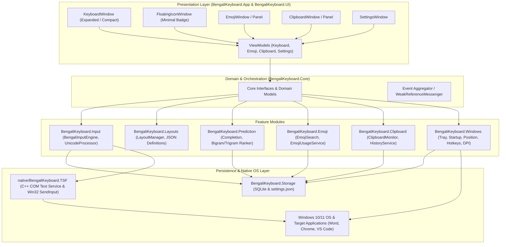
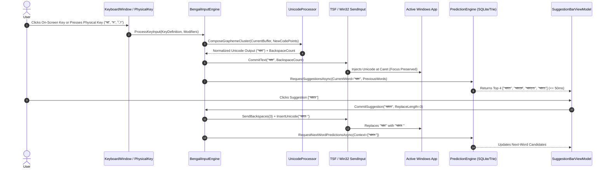
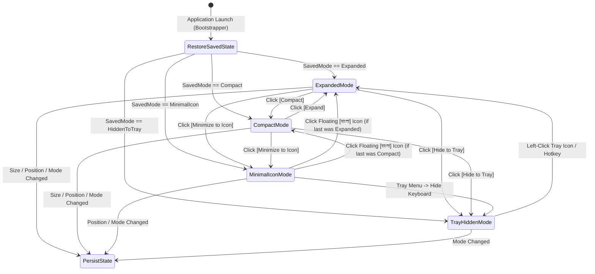

# System Architecture & Technical Specification
## BornoKey — Ridmik-Style Bengali Virtual Keyboard for Windows

---

## 1. Architectural Overview

**BornoKey** follows a **Modular Layered Architecture** combined with strict **MVVM (Model-View-ViewModel)** and **Dependency Injection (DI)**. Every functional domain—Input Engine, Keyboard Layouts, Predictive Text, Emoji, Clipboard, Windows OS Integration, and Local Storage—resides in its own decoupled module communicating strictly through interfaces defined in `BengaliKeyboard.Core`.

### Core Architectural Decisions
1. **Non-Activating Floating WPF Host (`WS_EX_NOACTIVATE`):**
   - A virtual on-screen keyboard must never steal keyboard focus from the target application (e.g., MS Word, Chrome, Notepad) when clicked.
   - `KeyboardWindow`, `EmojiWindow`, and `ClipboardWindow` override `OnSourceInitialized` and apply the Win32 extended window style `WS_EX_NOACTIVATE | WS_EX_TOOLWINDOW` via `SetWindowLongPtr`.
2. **Dual-Engine System-Wide Text Injection (TSF + Win32 `SendInput`):**
   - **Primary Production Channel:** Windows Text Services Framework (`native/BengaliKeyboard.TSF`) provides native IME composition, caret position tracking, and candidate integration across Win32, WPF, UWP/WinUI, and browser apps.
   - **Immediate Fallback / Direct Channel:** Managed Win32 `SendInput` (`KEYEVENTF_UNICODE`) in `BengaliKeyboard.Input` guarantees immediate Unicode character injection and grapheme-aware backspace replacement even without administrator COM registration.
3. **Shared Input Pipeline:**
   - Both on-screen mouse/touch clicks (`OnScreenInputService`) and physical keystrokes (`PhysicalKeyboardService`) feed into the same `BengaliInputEngine` and `UnicodeProcessor`, ensuring identical Bengali composition and real-time suggestion updates.
4. **Offline-Only Asynchronous Data Pipeline:**
   - All dictionary prefix lookups, n-gram queries, emoji keyword searches, and clipboard queries execute asynchronously off the WPF `Dispatcher` thread against indexed local SQLite databases and in-memory LRU caches.

---

## 2. Application Flow & Architecture Diagrams

### 2.1 High-Level Component Architecture



### 2.2 End-to-End Typing & Real-Time Prediction Flow



### 2.3 Window Presentation Mode State Machine



---

## 3. Complete Folder & File Structure

### 3.1 Solution Repository Structure (`BornoKey/`)

```text
BornoKey/
├── docs/                                   # Project Documentation & Live Memory
│   ├── PRD.md                              # Product Requirements Document
│   ├── Architecture.md                     # System Architecture & Technical Design
│   ├── Rules.md                            # Engineering Rules, Libraries & AI Boundaries
│   ├── Phases.md                           # Phased Implementation Roadmap
│   ├── Design.md                           # Visual Design System, Colors & Typography
│   ├── Memory.md                           # Live Progress & Session Memory Tracker
│   └── INSTALLATION.md                     # Setup & Installation Guide
├── README.md                               # Project Overview, Build & Install Guide
├── BengaliKeyboard.sln                     # .NET 10 Visual Studio Solution
│
├── src/
│   ├── BengaliKeyboard.App/                # Entry Point, DI Container & App Lifecycle
│   │   ├── BengaliKeyboard.App.csproj
│   │   ├── App.xaml
│   │   ├── App.xaml.cs
│   │   ├── Program.cs                      # Single-instance Mutex & Host startup
│   │   └── Bootstrapper.cs                 # Service registration & startup orchestration
│   │
│   ├── BengaliKeyboard.Core/               # Shared Interfaces, Domain Models & Events
│   │   ├── BengaliKeyboard.Core.csproj
│   │   ├── Enums/
│   │   │   ├── KeyboardMode.cs             # Expanded, Compact, MinimalIcon, HiddenToTray
│   │   │   ├── LanguageMode.cs             # Bangla, English
│   │   │   ├── LayoutLayer.cs              # Primary, Shift, Numbers, Symbols
│   │   │   ├── KeyType.cs                  # Character, VowelSign, Modifier, Backspace, Enter, Space, ModeSwitch
│   │   │   └── AppTheme.cs                 # Dark, Light, System
│   │   ├── Models/
│   │   │   ├── KeyDefinition.cs
│   │   │   ├── KeyboardLayoutModel.cs
│   │   │   ├── SuggestionCandidate.cs
│   │   │   ├── EmojiItem.cs
│   │   │   ├── ClipboardEntry.cs
│   │   │   ├── WindowStateConfig.cs
│   │   │   └── AppSettings.cs
│   │   ├── Interfaces/
│   │   │   ├── IBengaliInputEngine.cs
│   │   │   ├── ITextInjector.cs
│   │   │   ├── ILayoutManager.cs
│   │   │   ├── IPredictionService.cs
│   │   │   ├── IEmojiService.cs
│   │   │   ├── IClipboardService.cs
│   │   │   ├── IWindowManagerService.cs
│   │   │   ├── ISystemTrayService.cs
│   │   │   ├── IStartupService.cs
│   │   │   └── ISettingsService.cs
│   │   └── Events/
│   │       ├── LanguageChangedMessage.cs
│   │       ├── SuggestionsUpdatedMessage.cs
│   │       ├── WindowModeChangedMessage.cs
│   │       └── ThemeChangedMessage.cs
│   │
│   ├── BengaliKeyboard.UI/                 # WPF Windows, Custom Controls, Themes & ViewModels
│   │   ├── BengaliKeyboard.UI.csproj
│   │   ├── Windows/
│   │   │   ├── KeyboardWindow.xaml         # Main floating Ridmik keyboard window
│   │   │   ├── KeyboardWindow.xaml.cs      # WS_EX_NOACTIVATE interop & resize hooks
│   │   │   ├── FloatingIconWindow.xaml     # Mode C: Minimal draggable [বাংলা] badge
│   │   │   ├── EmojiWindow.xaml            # Emoji panel view / overlay
│   │   │   ├── ClipboardWindow.xaml        # Clipboard history view / overlay
│   │   │   └── SettingsWindow.xaml         # 8-section configuration window
│   │   ├── Controls/
│   │   │   ├── KeyboardKeyControl.xaml     # Reusable key with primary/secondary glyph & long-press
│   │   │   ├── SuggestionBarControl.xaml   # Top bar for 3-5 completions/predictions
│   │   │   ├── LanguageToggleControl.xaml  # [ বাংলা ] [ ENG ] pill switch
│   │   │   └── HeaderToolbarControl.xaml   # Drag handle, mode buttons, emoji/clipboard triggers
│   │   ├── Themes/
│   │   │   ├── Colors.Dark.xaml
│   │   │   ├── Colors.Light.xaml
│   │   │   ├── Typography.xaml
│   │   │   └── KeyStyles.xaml
│   │   └── ViewModels/
│   │       ├── KeyboardViewModel.cs
│   │       ├── SuggestionBarViewModel.cs
│   │       ├── EmojiViewModel.cs
│   │       ├── ClipboardViewModel.cs
│   │       └── SettingsViewModel.cs
│   │
│   ├── BengaliKeyboard.Layouts/            # Configurable JSON Keyboard Layout Engine
│   │   ├── BengaliKeyboard.Layouts.csproj
│   │   ├── LayoutManager.cs
│   │   ├── LayoutLoader.cs
│   │   └── Definitions/
│   │       ├── Bangla/
│   │       │   ├── PrimaryLayout.json      # Ridmik primary Bengali layout
│   │       │   ├── ShiftLayout.json        # Ridmik shifted Bengali layout
│   │       │   ├── NumberLayout.json       # Bengali numerals & math symbols
│   │       │   └── SymbolLayout.json       # Bengali punctuation & special symbols
│   │       └── English/
│   │           ├── QwertyLayout.json       # Standard English QWERTY + number row
│   │           └── SymbolLayout.json       # English symbols
│   │
│   ├── BengaliKeyboard.Input/              # Bengali Unicode Engine & OS Input Hooks
│   │   ├── BengaliKeyboard.Input.csproj
│   │   ├── BengaliInputEngine.cs           # Composes words, tracks active buffer, coordinates prediction
│   │   ├── UnicodeProcessor.cs             # Vowel sign attachment, Hasanta/conjunct rules, NFC normalization
│   │   ├── OnScreenInputService.cs         # Processes virtual key clicks & repeat timers
│   │   ├── PhysicalKeyboardService.cs      # Low-level WH_KEYBOARD_LL / TSF keystroke routing
│   │   └── TSF/
│   │       ├── TsfBridgeService.cs         # IPC / COM bridge to native TSF text service
│   │       └── Win32SendInputInjector.cs   # Direct KEYEVENTF_UNICODE text & backspace injector
│   │
│   ├── BengaliKeyboard.Prediction/         # Offline Smart Word Completion & Next-Word Engine
│   │   ├── BengaliKeyboard.Prediction.csproj
│   │   ├── DictionaryService.cs            # Prefix trie + SQLite unigram lookup
│   │   ├── WordCompletionService.cs        # Real-time partial word matcher
│   │   ├── NextWordPredictionService.cs    # Context-aware bigram & trigram predictor
│   │   ├── NGramModel.cs                   # Backoff scoring (Trigram -> Bigram -> Unigram)
│   │   └── SuggestionRankingService.cs     # Combines frequency, recency, and user history
│   │
│   ├── BengaliKeyboard.Emoji/              # Offline Emoji Search & Usage History
│   │   ├── BengaliKeyboard.Emoji.csproj
│   │   ├── EmojiRepository.cs              # Loads emoji metadata & categories
│   │   ├── EmojiSearchService.cs           # Fast keyword & alias prefix/substring search
│   │   └── EmojiUsageService.cs            # Tracks UsageCount & LastUsedUtc in SQLite
│   │
│   ├── BengaliKeyboard.Clipboard/          # Event-Driven Clipboard Manager
│   │   ├── BengaliKeyboard.Clipboard.csproj
│   │   ├── ClipboardMonitor.cs             # Win32 AddClipboardFormatListener (WM_CLIPBOARDUPDATE)
│   │   ├── ClipboardHistoryService.cs      # Deduplication, pin, retention, privacy filtering
│   │   └── ClipboardRepository.cs          # SQLite persistence for ClipboardHistory
│   │
│   ├── BengaliKeyboard.Windows/            # OS Integration, Window Positioning & Tray
│   │   ├── BengaliKeyboard.Windows.csproj
│   │   ├── NativeMethods.cs                # P/Invoke declarations (user32, dwmapi, shcore)
│   │   ├── SystemTrayService.cs            # NotifyIcon & 10-item context menu
│   │   ├── StartupService.cs               # Windows startup registry / shortcut manager
│   │   ├── WindowPositionService.cs        # Multi-monitor clamping, DPI scaling & state restore
│   │   ├── GlobalHotkeyService.cs          # RegisterHotKey / conflict-safe language toggle
│   │   └── MonitorService.cs               # EnumDisplayMonitors & DPI awareness helper
│   │
│   ├── BengaliKeyboard.Storage/            # SQLite Database & JSON Settings Persistence
│   │   ├── BengaliKeyboard.Storage.csproj
│   │   ├── AppPaths.cs                     # %LOCALAPPDATA%\BengaliKeyboard\ path resolver
│   │   ├── Database/
│   │   │   ├── SqliteConnectionFactory.cs
│   │   │   └── DatabaseInitializer.cs      # Schema creation & migrations
│   │   ├── Configuration/
│   │   │   └── JsonSettingsService.cs      # Atomic read/write for settings.json
│   │   └── Repositories/
│   │       └── UserDictionaryRepository.cs
│   │
│   └── BengaliKeyboard.Tests/              # Automated Unit & Integration Tests (xUnit)
│       ├── BengaliKeyboard.Tests.csproj
│       ├── UnicodeProcessorTests.cs
│       ├── LayoutLoaderTests.cs
│       ├── PredictionEngineTests.cs
│       ├── EmojiUsageTests.cs
│       ├── ClipboardServiceTests.cs
│       └── WindowPositionRestoreTests.cs
│
├── native/
│   └── BengaliKeyboard.TSF/                # Native C++ COM Text Services Framework DLL
│       ├── BengaliKeyboard.TSF.vcxproj
│       ├── DllMain.cpp
│       ├── Register.cpp                    # ITfInputProcessorProfiles & Category registration
│       ├── TextService.h
│       ├── TextService.cpp                 # ITfTextInputProcessorEx, ITfKeyEventSink
│       └── CompositionManager.cpp          # ITfCompositionSink & Unicode insertion
│
├── assets/
│   ├── Icons/
│   │   ├── app-icon.ico
│   │   └── tray-icon.ico
│   └── Fonts/
│       └── NotoSansBengali-Regular.ttf
│
├── data/
│   ├── Dictionary/
│   │   └── bn_dictionary_seed.json         # Offline Bengali words, frequencies, bigrams, trigrams
│   └── Emoji/
│       └── emoji_catalog.json              # Offline Unicode emoji catalog with keywords & categories
│
└── installer/
    └── BornoKeySetup.iss                   # Inno Setup installer script
```

### 3.2 Runtime Local AppData Structure (`%LOCALAPPDATA%\BengaliKeyboard\`)

```text
%LOCALAPPDATA%\BengaliKeyboard\
├── Config/
│   └── settings.json                       # Window mode, X/Y, Width/Height, Monitor, Theme, Shortcuts
├── Database/
│   ├── keyboard.db                         # User SQLite DB (EmojiUsage, ClipboardHistory, AppSettings)
│   └── dictionary.db                       # Indexed offline Bengali words, bigrams, and trigrams
├── Logs/
│   └── bornokey-YYYYMMDD.log               # Rolling operational logs (NEVER logs typed text/clipboard)
└── Cache/
```

---

## 4. Technology Stack

| Layer | Technology / Package | Version / Standard | Purpose |
|---|---|---|---|
| **Language** | C# (Managed) & C++20 (Native TSF) | C# 13 / .NET 10 | Primary application logic and native COM TSF text service |
| **Runtime** | .NET Desktop Runtime | `.NET 10.0-windows` | High-performance Windows desktop execution |
| **UI Framework** | WPF (Windows Presentation Foundation) | .NET 10 | Hardware-accelerated floating windows, vector scaling, custom templates |
| **MVVM Toolkit** | `CommunityToolkit.Mvvm` | `8.4.0+` | Source-generated `ObservableObject`, `RelayCommand`, `WeakReferenceMessenger` |
| **DI Container** | `Microsoft.Extensions.DependencyInjection` | `10.0.0` | Constructor injection and service lifetime management |
| **Database** | `Microsoft.Data.Sqlite` | `10.0.0` | Lightweight, zero-configuration local relational storage |
| **Serialization** | `System.Text.Json` | Built-in (.NET 10) | High-speed layout loading and atomic `settings.json` persistence |
| **System Tray** | `H.NotifyIcon.Wpf` or `System.Windows.Forms.NotifyIcon` interop | Native / WPF | Persistent notification area icon and context menu |
| **OS Interop** | Win32 P/Invoke (`user32.dll`, `imm32.dll`, `shcore.dll`) & TSF | Windows SDK | `WS_EX_NOACTIVATE`, `SendInput`, `AddClipboardFormatListener`, Multi-Monitor DPI |
| **Logging** | `Serilog` (`Serilog.Sinks.File`) | `4.x` | Structured rolling file diagnostics with strict privacy redaction |
| **Testing** | `xUnit`, `FluentAssertions`, `Moq` | Latest | Unit and integration testing across core modules |
| **Installer** | Inno Setup / `dotnet publish` | 6.x | Standalone user-mode or admin installer with startup & TSF setup |

---

## 5. Deep-Dive Module Specifications

### 5.1 Non-Activating Floating Window Mechanics
To ensure clicking an on-screen key types into the currently active external window (e.g., Notepad, Chrome, Word):
1. When `KeyboardWindow` initializes its `HwndSource`, it modifies its Win32 extended styles:
   ```csharp
   const int GWL_EXSTYLE = -20;
   const int WS_EX_NOACTIVATE = 0x08000000;
   const int WS_EX_TOOLWINDOW = 0x00000080;
   const int WS_EX_TOPMOST = 0x00000008;
   ```
2. It hooks `WndProc` to handle `WM_MOUSEACTIVATE` (`0x0021`) and returns `MA_NOACTIVATE` (`3`), preventing Windows from shifting focus away from the target application.
3. For interactive text inputs inside BornoKey itself (such as the **Emoji Search box** or **Clipboard Search box**), clicking those specific search controls temporarily allows activation so the user can type search queries, then restores `WS_EX_NOACTIVATE` when returning to the keyboard grid.

### 5.2 SQLite Database Schema (`keyboard.db` & `dictionary.db`)

```sql
-- 1. User Emoji Usage History (keyboard.db)
CREATE TABLE IF NOT EXISTS EmojiUsage (
    Emoji TEXT PRIMARY KEY,
    UsageCount INTEGER NOT NULL DEFAULT 1,
    LastUsedUtc TEXT NOT NULL
);
CREATE INDEX IF NOT EXISTS IX_EmojiUsage_Rank ON EmojiUsage (UsageCount DESC, LastUsedUtc DESC);

-- 2. User Clipboard History (keyboard.db)
CREATE TABLE IF NOT EXISTS ClipboardHistory (
    Id INTEGER PRIMARY KEY AUTOINCREMENT,
    Content TEXT NOT NULL,
    ContentHash TEXT NOT NULL UNIQUE,
    CreatedUtc TEXT NOT NULL,
    IsPinned INTEGER NOT NULL DEFAULT 0
);
CREATE INDEX IF NOT EXISTS IX_ClipboardHistory_PinnedCreated ON ClipboardHistory (IsPinned DESC, CreatedUtc DESC);

-- 3. Key-Value Application Settings Backup (keyboard.db)
CREATE TABLE IF NOT EXISTS ApplicationSettings (
    Key TEXT PRIMARY KEY,
    Value TEXT NOT NULL
);

-- 4. Offline Bengali Unigram Dictionary (dictionary.db)
CREATE TABLE IF NOT EXISTS BengaliWords (
    Word TEXT PRIMARY KEY,
    Prefix2 TEXT NOT NULL,
    Frequency INTEGER NOT NULL
);
CREATE INDEX IF NOT EXISTS IX_BengaliWords_Prefix ON BengaliWords (Prefix2, Frequency DESC);

-- 5. Offline Bigram Language Model (dictionary.db)
CREATE TABLE IF NOT EXISTS Bigrams (
    Word1 TEXT NOT NULL,
    Word2 TEXT NOT NULL,
    Frequency INTEGER NOT NULL,
    PRIMARY KEY (Word1, Word2)
);
CREATE INDEX IF NOT EXISTS IX_Bigrams_Lookup ON Bigrams (Word1, Frequency DESC);

-- 6. Offline Trigram Language Model (dictionary.db)
CREATE TABLE IF NOT EXISTS Trigrams (
    Word1 TEXT NOT NULL,
    Word2 TEXT NOT NULL,
    Word3 TEXT NOT NULL,
    Frequency INTEGER NOT NULL,
    PRIMARY KEY (Word1, Word2, Word3)
);
CREATE INDEX IF NOT EXISTS IX_Trigrams_Lookup ON Trigrams (Word1, Word2, Frequency DESC);
```

### 5.3 Multi-Monitor & DPI Safe Position Restoration
`WindowPositionService` executes the following algorithm on startup and monitor topology change (`SystemEvents.DisplaySettingsChanged`):
1. Reads `WindowStateConfig` (`Mode`, `Left`, `Top`, `Width`, `Height`, `MonitorDeviceName`, `DpiScale`).
2. Clamps `Width` and `Height` to `[MinWidth, MaxWidth]` and `[MinHeight, MaxHeight]` for the active mode (`Expanded`: min `520x210`, default `850x310`; `Compact`: default `620x230`; `MinimalIcon`: `68x42`).
3. Checks if the saved `(Left, Top, Width, Height)` rectangle intersects at least 60% with the `WorkingArea` of any currently connected display via `EnumDisplayMonitors`.
4. If the previous monitor was disconnected or coordinates are off-screen, anchors the keyboard centered horizontally and `40px` above the taskbar on the primary monitor's `WorkingArea`.
