# Phased Implementation Roadmap
## BornoKey — Ridmik-Style Bengali Virtual Keyboard for Windows

To guarantee engineering quality, zero broken builds, and full verification of every requirement, **BornoKey** is broken down into **10 sequential development phases**. Each phase produces a compilable, testable, and verifiable milestone before the next phase begins.

---

## Phase Overview Diagram

```mermaid
flowchart LR
    P1["Phase 1: Foundation & Storage"] --> P2["Phase 2: Ridmik UI & Layouts"]
    P2 --> P3["Phase 3: Bengali Input & TSF"]
    P3 --> P4["Phase 4: Floating Modes & Scaling"]
    P4 --> P5["Phase 5: System Tray & Startup"]
    P5 --> P6["Phase 6: Emoji & Usage History"]
    P6 --> P7["Phase 7: Clipboard Manager"]
    P7 --> P8["Phase 8: Smart Prediction Engine"]
    P8 --> P9["Phase 9: Settings & Themes"]
    P9 --> P10["Phase 10: Testing & Installer"]
```

---

## Phase 1 — Project Foundation, DI & Storage Infrastructure

### 1.1 Functionality & Scope
Establish the `.NET 10` multi-project solution structure, core domain contracts, MVVM foundation, Dependency Injection container, single-instance enforcement, structured logging, and local SQLite + JSON storage engine.

### 1.2 Files to Create
- `BengaliKeyboard.sln`
- `src/BengaliKeyboard.Core/BengaliKeyboard.Core.csproj`
- `src/BengaliKeyboard.Core/Enums/*.cs` (`KeyboardMode`, `LanguageMode`, `LayoutLayer`, `KeyType`, `AppTheme`)
- `src/BengaliKeyboard.Core/Models/*.cs` (`KeyDefinition`, `KeyboardLayoutModel`, `SuggestionCandidate`, `EmojiItem`, `ClipboardEntry`, `WindowStateConfig`, `AppSettings`)
- `src/BengaliKeyboard.Core/Interfaces/*.cs` (All service contracts)
- `src/BengaliKeyboard.Core/Events/*.cs` (Messenger event records)
- `src/BengaliKeyboard.Storage/BengaliKeyboard.Storage.csproj`
- `src/BengaliKeyboard.Storage/AppPaths.cs`
- `src/BengaliKeyboard.Storage/Database/SqliteConnectionFactory.cs`
- `src/BengaliKeyboard.Storage/Database/DatabaseInitializer.cs`
- `src/BengaliKeyboard.Storage/Configuration/JsonSettingsService.cs`
- `src/BengaliKeyboard.App/BengaliKeyboard.App.csproj`, `Program.cs`, `Bootstrapper.cs`, `App.xaml`, `App.xaml.cs`
- `src/BengaliKeyboard.Tests/BengaliKeyboard.Tests.csproj`

### 1.3 Verification Criteria
- `dotnet build` compiles with 0 warnings and 0 errors.
- Single-instance `Mutex` prevents duplicate app launches.
- `DatabaseInitializer` creates `%LOCALAPPDATA%\BengaliKeyboard\Database\keyboard.db` and `Config\settings.json` cleanly.
- **Deliverable:** Working `.NET 10` WPF desktop solution foundation with DI and local persistence.

---

## Phase 2 — Ridmik-Style Keyboard UI & Configurable Layout Engine

### 2.1 Functionality & Scope
Implement the JSON-driven keyboard layout loader and build the Ridmik-inspired visual keyboard interface with reusable key controls, dedicated number row, Bangla Primary/Shift/Symbol layers, English QWERTY/Symbol layers, `[ বাংলা ]` / `[ ENG ]` mode toggle, and default Dark theme.

### 2.2 Files to Create
- `src/BengaliKeyboard.Layouts/BengaliKeyboard.Layouts.csproj`
- `src/BengaliKeyboard.Layouts/Definitions/Bangla/PrimaryLayout.json`
- `src/BengaliKeyboard.Layouts/Definitions/Bangla/ShiftLayout.json`
- `src/BengaliKeyboard.Layouts/Definitions/Bangla/NumberLayout.json`
- `src/BengaliKeyboard.Layouts/Definitions/Bangla/SymbolLayout.json`
- `src/BengaliKeyboard.Layouts/Definitions/English/QwertyLayout.json`
- `src/BengaliKeyboard.Layouts/Definitions/English/SymbolLayout.json`
- `src/BengaliKeyboard.Layouts/LayoutLoader.cs` & `LayoutManager.cs`
- `src/BengaliKeyboard.UI/BengaliKeyboard.UI.csproj`
- `src/BengaliKeyboard.UI/Themes/Colors.Dark.xaml`, `Typography.xaml`, `KeyStyles.xaml`
- `src/BengaliKeyboard.UI/Controls/KeyboardKeyControl.xaml` (`.cs`)
- `src/BengaliKeyboard.UI/Controls/SuggestionBarControl.xaml` (`.cs`)
- `src/BengaliKeyboard.UI/Controls/LanguageToggleControl.xaml` (`.cs`)
- `src/BengaliKeyboard.UI/Controls/HeaderToolbarControl.xaml` (`.cs`)
- `src/BengaliKeyboard.UI/Windows/KeyboardWindow.xaml` (`.cs`)
- `src/BengaliKeyboard.UI/ViewModels/KeyboardViewModel.cs`
- `src/BengaliKeyboard.Tests/LayoutLoaderTests.cs`

### 2.3 Verification Criteria
- All JSON layout files deserialize accurately and pass unit tests in `LayoutLoaderTests`.
- Clicking `Shift`, `?123`, and `[ বাংলা ] / [ ENG ]` dynamically updates the rendered keyboard rows immediately.
- **Deliverable:** Complete Ridmik-style visual keyboard with data-driven Bangla and English layouts.

---

## Phase 3 — Bengali Unicode Input Engine & System-Wide Text Injection

### 3.1 Functionality & Scope
Build the core Bengali Unicode composition engine, non-activating window interop (`WS_EX_NOACTIVATE`), system-wide text injection (`Win32SendInputInjector` + Native C++ TSF component), on-screen key click + press-and-hold repeat handler, and physical keyboard integration.

### 3.2 Files to Create
- `src/BengaliKeyboard.Input/BengaliKeyboard.Input.csproj`
- `src/BengaliKeyboard.Input/UnicodeProcessor.cs`
- `src/BengaliKeyboard.Input/BengaliInputEngine.cs`
- `src/BengaliKeyboard.Input/OnScreenInputService.cs`
- `src/BengaliKeyboard.Input/PhysicalKeyboardService.cs`
- `src/BengaliKeyboard.Input/TSF/Win32SendInputInjector.cs`
- `src/BengaliKeyboard.Input/TSF/TsfBridgeService.cs`
- `native/BengaliKeyboard.TSF/BengaliKeyboard.TSF.vcxproj`, `DllMain.cpp`, `Register.cpp`, `TextService.h`, `TextService.cpp`, `CompositionManager.cpp`
- `src/BengaliKeyboard.Tests/UnicodeProcessorTests.cs`

### 3.3 Verification Criteria
- Clicking keys on `KeyboardWindow` never steals focus from Notepad, Word, or Chrome (`WS_EX_NOACTIVATE` active).
- Both virtual key clicks and physical keyboard presses output valid NFC-normalized Bengali vowels, consonants, *kars* (`া`, `ি`, `ী`, `ু`, `ে`, `ো`), and conjuncts (`ক্ষ`, `জ্ঞ`, `ত্র`, `ম্প`).
- Grapheme-aware backspace deletes cleanly and updates the composition buffer.
- **Deliverable:** True system-wide Bengali typing across Windows applications via both virtual and physical keyboards.

---

## Phase 4 — Adaptive Floating Keyboard & 4-Mode Window Management

### 4.1 Functionality & Scope
Implement the 4 presentation modes (`Expanded`, `Compact`, `MinimalIcon`, `HiddenToTray`), proportional UI scaling (`Viewbox` / responsive grid), free window dragging, smooth border/corner resizing with min/max bounds, `AlwaysOnTop`, multi-monitor clamping, DPI scaling, and automatic state persistence.

### 4.2 Files to Create
- `src/BengaliKeyboard.UI/Windows/FloatingIconWindow.xaml` (`.cs`)
- `src/BengaliKeyboard.Windows/BengaliKeyboard.Windows.csproj`
- `src/BengaliKeyboard.Windows/NativeMethods.cs`
- `src/BengaliKeyboard.Windows/MonitorService.cs`
- `src/BengaliKeyboard.Windows/WindowPositionService.cs`
- `src/BengaliKeyboard.Tests/WindowPositionRestoreTests.cs`

### 4.3 Verification Criteria
- Users can freely drag and resize the keyboard; keys, Bengali glyphs, and the suggestion bar scale proportionally without distortion.
- Switching between `Expanded`, `Compact`, `Minimal Icon` (`[ বাংলা ]` floating badge), and `Hidden to Tray` works reversibly.
- Off-screen or disconnected monitor coordinates automatically snap back to the visible primary monitor working area.
- **Deliverable:** Adaptive 4-mode floating keyboard with persistent geometry and multi-monitor/DPI safety.

---

## Phase 5 — Windows System Tray, Auto-Startup & State Restoration

### 5.1 Functionality & Scope
Implement the persistent Windows notification area (`NotifyIcon`) with its 10-item context menu, global keyboard shortcuts (`GlobalHotkeyService`), `Start with Windows` startup registration (`StartupService`), and full startup state restoration.

### 5.2 Files to Create
- `src/BengaliKeyboard.Windows/SystemTrayService.cs`
- `src/BengaliKeyboard.Windows/StartupService.cs`
- `src/BengaliKeyboard.Windows/GlobalHotkeyService.cs`
- `assets/Icons/app-icon.ico`, `assets/Icons/tray-icon.ico`

### 5.3 Verification Criteria
- Closing or hiding the keyboard keeps BornoKey running quietly in the system tray (< 1% idle CPU).
- Left-clicking or double-clicking the tray icon restores the last visible keyboard mode; right-clicking opens the full 10-item menu.
- Restarting the application restores the exact saved mode (including if last left in Minimal Icon or Hidden Tray mode), coordinates, dimensions, and language.
- **Deliverable:** Persistent Windows background utility with system tray, global hotkeys, and startup restoration.

---

## Phase 6 — Emoji Keyboard, Keyword Search & Frequently Used History

### 6.1 Functionality & Scope
Build the embedded Emoji Keyboard panel with 10 categories, instant offline keyword search (`smile`, `heart`, `food`), multi-codepoint Unicode emoji insertion, and mandatory SQLite-backed Frequently Used emoji tracking (`EmojiUsage` table).

### 6.2 Files to Create
- `data/Emoji/emoji_catalog.json`
- `src/BengaliKeyboard.Emoji/BengaliKeyboard.Emoji.csproj`
- `src/BengaliKeyboard.Emoji/EmojiRepository.cs`
- `src/BengaliKeyboard.Emoji/EmojiSearchService.cs`
- `src/BengaliKeyboard.Emoji/EmojiUsageService.cs`
- `src/BengaliKeyboard.UI/Windows/EmojiWindow.xaml` (`.cs`)
- `src/BengaliKeyboard.UI/ViewModels/EmojiViewModel.cs`
- `src/BengaliKeyboard.Tests/EmojiUsageTests.cs`

### 6.3 Verification Criteria
- Searching keywords (`smile`, `heart`, `food`, `fire`) filters emojis in real time.
- Selecting any emoji inserts it into the active Windows app and updates `UsageCount` and `LastUsedUtc` in SQLite.
- Frequently Used emojis persist across restarts without duplicates and can be cleared from settings.
- **Deliverable:** Full-featured offline Emoji Keyboard with persistent usage frequency history.

---

## Phase 7 — Privacy-First Clipboard History Manager

### 7.1 Functionality & Scope
Implement the event-driven Windows clipboard listener (`AddClipboardFormatListener`), local SQLite storage (`ClipboardHistory` table), pinning (`📌`), real-time search, single-click paste into active applications, individual deletion, clear all, capacity/retention enforcement, and privacy protections.

### 7.2 Files to Create
- `src/BengaliKeyboard.Clipboard/BengaliKeyboard.Clipboard.csproj`
- `src/BengaliKeyboard.Clipboard/ClipboardMonitor.cs`
- `src/BengaliKeyboard.Clipboard/ClipboardRepository.cs`
- `src/BengaliKeyboard.Clipboard/ClipboardHistoryService.cs`
- `src/BengaliKeyboard.UI/Windows/ClipboardWindow.xaml` (`.cs`)
- `src/BengaliKeyboard.UI/ViewModels/ClipboardViewModel.cs`
- `src/BengaliKeyboard.Tests/ClipboardServiceTests.cs`

### 7.3 Verification Criteria
- Copying Bengali or English text in any app immediately adds the entry to Clipboard History via `WM_CLIPBOARDUPDATE` (zero polling).
- Clicking a clipboard entry inserts/pastes it directly into the focused target window.
- Pinning, unpinning, searching, deleting, clearing unpinned items, and pausing monitoring work and persist across restarts.
- **Deliverable:** Built-in privacy-first desktop Clipboard History Manager.

---

## Phase 8 — Smart Offline Bengali Predictive Text Engine

### 8.1 Functionality & Scope
Implement the offline Bengali dictionary (`BengaliWords`), real-time partial word completion (`WordCompletionService`), and context-aware `Bigram` + `Trigram` next-word prediction engine (`NextWordPredictionService`, `NGramModel`, `SuggestionRankingService`), wired directly to `SuggestionBarControl`.

### 8.2 Files to Create
- `data/Dictionary/bn_dictionary_seed.json`
- `src/BengaliKeyboard.Prediction/BengaliKeyboard.Prediction.csproj`
- `src/BengaliKeyboard.Prediction/DictionaryService.cs`
- `src/BengaliKeyboard.Prediction/WordCompletionService.cs`
- `src/BengaliKeyboard.Prediction/NGramModel.cs`
- `src/BengaliKeyboard.Prediction/NextWordPredictionService.cs`
- `src/BengaliKeyboard.Prediction/SuggestionRankingService.cs`
- `src/BengaliKeyboard.UI/ViewModels/SuggestionBarViewModel.cs`
- `src/BengaliKeyboard.Tests/PredictionEngineTests.cs`

### 8.3 Verification Criteria
- Typing `আমা` surfaces `আমার`, `আমাকে`, `আমাদের`, `আমায়` in **≤ 50 ms** off the UI thread.
- Clicking a completion replaces the partial prefix `আমা` with the full word `আমার ` in the active external app.
- Completing `আমি` or `আমি বাংলা` automatically displays context-ranked next-word predictions from the bigram/trigram model.
- **Deliverable:** Offline smart Bengali predictive keyboard with real-time completion and next-word suggestions.

---

## Phase 9 — Customization, Themes & Settings Panel

### 9.1 Functionality & Scope
Build the 8-section `SettingsWindow` (General, Keyboard, Appearance, Prediction, Emoji, Clipboard, Shortcuts, Privacy), add Light and System Default theme dictionaries alongside Dark theme, support custom opacity/colors/corner radius, and perform memory/CPU optimization.

### 9.2 Files to Create
- `src/BengaliKeyboard.UI/Themes/Colors.Light.xaml`
- `src/BengaliKeyboard.UI/Windows/SettingsWindow.xaml` (`.cs`)
- `src/BengaliKeyboard.UI/ViewModels/SettingsViewModel.cs`

### 9.3 Verification Criteria
- All 8 settings tabs modify live application behavior and persist immediately to `settings.json` / `keyboard.db`.
- Switching between Dark, Light, and System Default themes updates all windows dynamically without restart.
- Privacy actions (`Clear Emoji History`, `Clear Clipboard History`, `Clear All Data`, `Reset Settings`) execute cleanly.
- **Deliverable:** Complete customizable settings suite and polished Windows 11-inspired UI.

---

## Phase 10 — Comprehensive Testing, Documentation & Release Installer

### 10.1 Functionality & Scope
Execute full unit and integration test suites, verify cross-application typing compatibility (Notepad, Word, Chrome, Edge, Firefox, VS Code, Windows Search), write comprehensive `README.md` and installation documentation, and create the Windows installer script (`installer/BornoKeySetup.iss`).

### 10.2 Files to Create / Update
- `README.md`
- `docs/INSTALLATION.md`
- `installer/BornoKeySetup.iss`
- Full verification pass on `src/BengaliKeyboard.Tests/*.cs`

### 10.3 Verification Criteria
- `dotnet test` passes 100% of unit and integration tests.
- Release build (`dotnet publish -c Release`) produces a clean, self-contained or framework-dependent deployment package ready for installation.
- **Deliverable:** Production-ready, installable **BornoKey** release package.
