# Threat Model — BornoKey (Ridmik-Style Bengali Virtual Keyboard for Windows)

## 0. Current Project Implementation State & Assessment Scope

> **Project Reality Verification:**  
> Inspection of the complete workspace (`BornoKey/`) confirms that the project is currently in the **Pre-Coding Specification & Architecture Stage** (`docs/Memory.md:9-15`).  
> - **Existing Files:** `Ridmik-Style Bengali Virtual Keyboard for Windows.md` (1,754-line SRS) and six specification documents in `docs/` (`PRD.md`, `Architecture.md`, `Rules.md`, `Phases.md`, `Design.md`, `Memory.md`).  
> - **Executable Code State:** No `.sln`, `.csproj`, `.cs`, `.cpp`, `.db`, `.json`, or `.git` files exist on disk yet.  
> - **Control Status:** All security mechanisms described in the repository exist strictly as **architectural specifications and design rules**, not yet as active runtime protections. This threat model evaluates the actual documented architecture, database schemas, Win32/TSF interop designs, and storage specifications as written.

---

## 1. Assets

| Asset ID | Asset Name | Description & Sensitivity | Planned Storage / Location |
|---|---|---|---|
| **A-01** | **Live User Keystrokes & Composition Buffer** | Real-time Bengali and English characters typed via physical keyboard or virtual on-screen keys. **Sensitivity: CRITICAL** (may happen while user interacts with sensitive apps, messaging, or credentials). | In-memory within `BengaliInputEngine` (`docs/Architecture.md:183`) and `native/BengaliKeyboard.TSF` (`docs/Architecture.md:226`). |
| **A-02** | **User Clipboard History Database (`ClipboardHistory`)** | Historical plain/Unicode text copied by the user across the Windows session, including pinned items. **Sensitivity: CRITICAL** (`Ridmik-Style Bengali Virtual Keyboard for Windows.md:634`: *"Clipboard data can contain passwords, personal information, and confidential content"*). | `%LOCALAPPDATA%\BengaliKeyboard\Database\keyboard.db` (`docs/Architecture.md:254`, `302-308`). |
| **A-03** | **Native TSF Text Service DLL (`BengaliKeyboard.TSF.dll`)** | C++ COM in-process server loaded into target Windows applications via Windows Text Services Framework. **Sensitivity: CRITICAL** (code integrity determines security of every host process loading the IME). | `native/BengaliKeyboard.TSF/` (`docs/Architecture.md:226-233`) & Windows COM Registry (`InprocServer32`). |
| **A-04** | **User Emoji Usage & Custom Dictionary Data** | Persistent emoji frequency/recency history (`EmojiUsage` table) and user-added Bengali words (`UserDictionaryRepository`). **Sensitivity: MEDIUM** (reveals communication habits and personal vocabulary). | `%LOCALAPPDATA%\BengaliKeyboard\Database\keyboard.db` (`docs/Architecture.md:295-300`, `216`). |
| **A-05** | **Application Configuration & Window State (`settings.json`)** | Window coordinates, presentation mode, hotkeys, startup preferences, and privacy toggles. **Sensitivity: LOW–MEDIUM** (tampering can hide UI, alter hotkeys, or re-enable disabled clipboard monitoring). | `%LOCALAPPDATA%\BengaliKeyboard\Config\settings.json` (`docs/Architecture.md:252`). |
| **A-06** | **Offline Bengali Language Model (`dictionary.db` & JSON Layouts)** | Unigram (`BengaliWords`), `Bigrams`, `Trigrams` tables and JSON keyboard layout definitions. **Sensitivity: LOW (Confidentiality) / HIGH (Integrity)** (tampering alters injected characters or suggestions). | `%LOCALAPPDATA%\BengaliKeyboard\Database\dictionary.db` & `src/BengaliKeyboard.Layouts/Definitions/` (`docs/Architecture.md:171-179`, `315-341`). |
| **A-07** | **Operational Diagnostic Logs** | Rolling Serilog files recording startup, errors, and state transitions. **Sensitivity: MEDIUM** (must never contain leaked keystrokes or clipboard text). | `%LOCALAPPDATA%\BengaliKeyboard\Logs\bornokey-YYYYMMDD.log` (`docs/Architecture.md:256`). |

---

## 2. Trust Boundaries

```mermaid
flowchart TD
    subgraph TB4["Trust Boundary 4: High-Integrity / Protected OS Contexts"]
        ELEV["Elevated (Admin) Windows Processes (UIPI Protected)"]
        SECD["Windows Secure Desktop (UAC / Winlogon / CredUI)"]
    end

    subgraph TB1["Trust Boundary 1: Standard User Session (Medium Integrity)"]
        subgraph AppProc["BornoKey Managed Process (.NET 10 WPF - asInvoker)"]
            UI["KeyboardWindow / Emoji / Clipboard UI (WS_EX_NOACTIVATE)"]
            ENG["BengaliInputEngine & PhysicalKeyboardService (WH_KEYBOARD_LL)"]
            CLP["ClipboardMonitor (WM_CLIPBOARDUPDATE)"]
            IPC_SRV["TsfBridgeService / Single-Instance Named Pipe"]
        end

        subgraph TargetApp["External Target Windows Application (Word, Chrome, Notepad)"]
            TSF_DLL["In-Process BengaliKeyboard.TSF.dll (COM Text Service)"]
            CARET["Target Application Text Field / Caret"]
        end

        OTHER_PROC["Other Processes in User Session / Low-Integrity Sandboxed Apps"]
    end

    subgraph TB2["Trust Boundary 2: Local Filesystem & Registry (%LOCALAPPDATA% / HKCU)"]
        DB["keyboard.db (ClipboardHistory, EmojiUsage)"]
        DICT["dictionary.db & Layout JSONs"]
        CFG["settings.json & Logs"]
        REG["HKCU\\...\\Run (Auto-Startup) & COM Registration"]
    end

    subgraph TB3["Trust Boundary 3: Multi-Session OS Kernel Namespace"]
        MUTEX["Global\\BornoKey_SingleInstance_Mutex"]
    end

    ENG -- "Win32 SendInput (KEYEVENTF_UNICODE)" --> CARET
    IPC_SRV <-- "Local IPC / COM Bridge" --> TSF_DLL
    TSF_DLL -- "ITfCompositionSink" --> CARET
    CLP <-- "OS Clipboard Notification" --> TargetApp
    AppProc <-- "File I/O (Microsoft.Data.Sqlite / System.Text.Json)" --> DB & DICT & CFG
    AppProc <-- "Registry Read/Write" --> REG
    AppProc -- "Named Mutex" --> MUTEX
    OTHER_PROC -. "Potential Untrusted Local Access" .-> DB & IPC_SRV & MUTEX
    ENG -. "Blocked by Windows UIPI / Secure Desktop" .-> ELEV & SECD
```

| Boundary ID | Boundary Name | Description |
|---|---|---|
| **TB-01** | **Process & Integrity Boundary (BornoKey ↔ Target Windows Apps)** | BornoKey runs as a standard user (`asInvoker`, `docs/PRD.md:149`) and injects Unicode text into foreign processes via `SendInput` or an in-process COM DLL (`BengaliKeyboard.TSF.dll`). Cross-process communication with Low-Integrity (AppContainer/Browser sandbox) or High-Integrity (Admin) processes crosses Windows Mandatory Integrity Control (MIC) and UIPI boundaries. |
| **TB-02** | **Persistent Local Storage Boundary (BornoKey ↔ `%LOCALAPPDATA%` & `HKCU`)** | Everything written to `%LOCALAPPDATA%\BengaliKeyboard\` (`keyboard.db`, `settings.json`, `Logs/`) is readable and writable by any process executing under the same Windows user account. |
| **TB-03** | **Windows Session / Kernel Object Boundary (`Global\` vs `Local\`)** | Kernel objects prefixed with `Global\` (`Global\BornoKey_SingleInstance_Mutex`, `docs/Rules.md:27`) are visible across all Windows Terminal Services / Fast User Switching sessions on the machine. |
| **TB-04** | **UIPI & Secure Desktop Boundary (Medium Integrity ↔ Admin / `Winlogon`)** | Standard-user input hooks and `SendInput` calls are blocked by Windows User Interface Privilege Isolation (UIPI) from interacting with elevated Administrator processes or the Secure Desktop (UAC prompts, lock screen). |

---

## 3. Actors

| Actor | Trust Level | Capabilities & Motivation |
|---|---|---|
| **Primary Desktop User** | Trusted | Operates the physical/virtual keyboard, manages clipboard items, configures settings. May inadvertently copy sensitive passwords, API keys, or personal data to the Windows clipboard. |
| **Same-User Malicious Process / Info-Stealer** | Untrusted (Local) | Runs under the same non-admin Windows user context; can read unencrypted files in `%LOCALAPPDATA%`, connect to unrestricted local Named Pipes, or modify unlocked JSON/SQLite files. |
| **Other Local Windows User (Multi-User PC)** | Untrusted (Cross-Session) | Logged into a separate Windows account on the same shared PC; can interact with `Global\` kernel objects or improperly ACL'd shared directories. |
| **Sandboxed / Low-Integrity Process** | Untrusted (Restricted) | Browser renderer or AppContainer app attempting to send spoofed IPC messages or Windows messages (`WM_COPYDATA` / custom messages) to the medium-integrity BornoKey process. |
| **External Network Attacker** | Untrusted (Remote) | Has **no direct network reachability** because BornoKey has zero network listeners or outbound HTTP clients (`docs/PRD.md:148`), unless delivering a malicious document/payload that exploits clipboard processing. |

---

## 4. Entry Points

| Entry Point ID | Surface | Architectural Location | Input Source |
|---|---|---|---|
| **EP-01** | **System Clipboard Listener (`WM_CLIPBOARDUPDATE`)** | `src/BengaliKeyboard.Clipboard/ClipboardMonitor.cs` (`docs/Architecture.md:201`) | Arbitrary Unicode text copied by the user or programmatically placed on the Windows clipboard by any application/website. |
| **EP-02** | **Physical Keyboard Hook (`WH_KEYBOARD_LL` / TSF Key Event Sink)** | `src/BengaliKeyboard.Input/PhysicalKeyboardService.cs` (`docs/Architecture.md:185`) | Low-level physical key scan codes and virtual key events from the OS input queue. |
| **EP-03** | **Local IPC Bridge (`TsfBridgeService` & Single-Instance Pipe)** | `src/BengaliKeyboard.Input/TSF/TsfBridgeService.cs` (`docs/Architecture.md:187`) & `Program.cs` (`docs/Rules.md:27`) | Local inter-process messages between TSF COM instances / secondary processes and the main WPF process. |
| **EP-04** | **Win32 Window Message Loop (`WndProc`)** | `src/BengaliKeyboard.UI/Windows/KeyboardWindow.xaml.cs` (`docs/Architecture.md:146`, `287`) | Windows messages (`WM_MOUSEACTIVATE`, `WM_CLIPBOARDUPDATE`, `WM_HOTKEY`, `WM_DPICHANGED`). |
| **EP-05** | **JSON Configuration & Layout Files** | `JsonSettingsService.cs` (`docs/Architecture.md:214`) & `LayoutLoader.cs` (`docs/Architecture.md:170`) | Local files at `%LOCALAPPDATA%\BengaliKeyboard\Config\settings.json`, `Definitions/**/*.json`, and `emoji_catalog.json`. |
| **EP-06** | **Local SQLite Databases (`keyboard.db`, `dictionary.db`)** | `SqliteConnectionFactory.cs` (`docs/Architecture.md:211`) | SQLite database files in `%LOCALAPPDATA%\BengaliKeyboard\Database\`. |
| **EP-07** | **In-Process COM Registration (`BengaliKeyboard.TSF.dll`)** | `native/BengaliKeyboard.TSF/Register.cpp` (`docs/Architecture.md:229`) | Loaded by `ctfmon.exe` and target Windows applications via COM `InprocServer32` registry keys. |

---

## 5. Threats & Attack Scenarios (STRIDE Analysis)

| Threat ID | STRIDE Category | Threat Description & Attack Scenario | Target Asset / Entry Point | Impact | Likelihood | Risk Severity |
|---|---|---|---|---|---|---|
| **T-01** | **Information Disclosure** | **Plaintext Harvesting of `ClipboardHistory` Database:** User copies passwords, session tokens, or private messages. `ClipboardMonitor` writes them in plaintext into `keyboard.db` (`Content TEXT NOT NULL`). A local info-stealer script or unauthorized person with access to the user profile reads `%LOCALAPPDATA%\BengaliKeyboard\Database\keyboard.db` directly. | **A-02** / **EP-06** | High | High | **HIGH** |
| **T-02** | **Information Disclosure** | **Capturing Password Manager Clips via Incomplete Format Filtering:** A user copies a password from Bitwarden, 1Password, or Windows CredUI that sets `CanIncludeInClipboardHistory = 0` rather than `CF_EXCLUDE_CLIPBOARD_CONTENT_FROM_MONITOR_PROCESSING`. BornoKey captures and persists the password in `ClipboardHistory`. | **A-02** / **EP-01** | High | Medium | **HIGH** |
| **T-03** | **Elevation of Privilege / Tampering** | **TSF COM DLL Hijacking (`InprocServer32`):** If `BengaliKeyboard.TSF.dll` is registered from a user-writable directory (such as `%LOCALAPPDATA%`) or with weak file ACLs, a local attacker replaces the DLL so it is automatically loaded into every application (including potentially elevated processes if registered machine-wide). | **A-03** / **EP-07** | Critical | Medium | **HIGH** |
| **T-04** | **Spoofing / Elevation of Privilege** | **Unauthenticated Local IPC Injection:** A sandboxed/low-integrity process connects to the `TsfBridgeService` or single-instance Named Pipe (if created with default permissive DACLs) and sends crafted commands to inject arbitrary keystrokes via `Win32SendInputInjector` into the user's active terminal or browser. | **A-01** / **EP-03** | High | Medium | **MEDIUM–HIGH** |
| **T-05** | **Information Disclosure** | **Over-Broad `WH_KEYBOARD_LL` Hook Active During English / Password Entry:** If `PhysicalKeyboardService` keeps a global `WH_KEYBOARD_LL` hook active while in `English` mode or while typing into password fields, every physical keystroke passes through managed memory unnecessarily. | **A-01** / **EP-02** | Medium | Medium | **MEDIUM** |
| **T-06** | **Denial of Service** | **Clipboard Memory Exhaustion (Mega-Clip DoS):** User copies a 200 MB log or binary text blob in another app. `ClipboardMonitor` reads the entire string into memory, hashes it, and inserts it into SQLite without size bounds, spiking RAM far above the 100 MB limit and freezing the WPF dispatcher. | **A-02** / **EP-01** | Medium | High | **MEDIUM** |
| **T-07** | **Denial of Service / Tampering** | **Cross-Session Mutex Squatting (`Global\` Namespace):** On a multi-user Windows PC, User A creates `Global\BornoKey_SingleInstance_Mutex`. When User B logs in on another session and launches BornoKey, `Program.cs` sees the mutex is already held and immediately exits. | **TB-03** / **EP-03** | Medium | Low–Medium | **MEDIUM** |
| **T-08** | **Tampering** | **Malicious Modification of `Definitions/*.json` or `settings.json`:** A local script alters `PrimaryLayout.json` to map a key `UnicodeOutput` to a multi-character command string, or edits `settings.json` to place the window off-screen/invisible (`Opacity: 0.0`) while re-enabling clipboard capture. | **A-05, A-06** / **EP-05** | Medium | Low | **LOW–MEDIUM** |

---

## 6. Existing Mitigations (Documented in Specification vs. Runtime Reality)

> **Important Verification Note:** Because no source code has been written yet (`docs/Memory.md:9-15`), **none of the mitigations below exist in executable code today**. They exist solely as requirements and design specifications in `Ridmik-Style Bengali Virtual Keyboard for Windows.md` and `docs/*.md`:

1. **100% Offline Architecture (Specified):** Zero network listeners and zero external cloud/AI API calls (`Ridmik-Style Bengali Virtual Keyboard for Windows.md:464`, `1249-1251`; `docs/PRD.md:148`).
2. **Standard User Execution (Specified):** Runs with `requestedExecutionLevel level="asInvoker"` without requiring administrator privileges for normal runtime (`Ridmik-Style Bengali Virtual Keyboard for Windows.md:1205`; `docs/Rules.md:45`).
3. **No Keystroke or Clipboard Logging (Specified):** Explicit prohibition against logging typed characters or clipboard text to Serilog files (`Ridmik-Style Bengali Virtual Keyboard for Windows.md:645`, `1286`; `docs/Rules.md:44`).
4. **Parameterized SQL Queries (Specified):** Mandatory use of parameterized `SqliteCommand` queries in `Microsoft.Data.Sqlite` (`docs/Rules.md:15`).
5. **Clipboard Monitoring Pause & Clear Controls (Specified):** User-accessible settings to disable clipboard monitoring, set retention periods, and clear history (`Ridmik-Style Bengali Virtual Keyboard for Windows.md:640-642`; `docs/PRD.md:111-112`).
6. **Multi-Monitor Off-Screen Clamping (Specified):** `WindowPositionService` clamps `Width`/`Height` to `[MinWidth, MaxWidth]` and intersects coordinates with connected monitors (`docs/Architecture.md:346-350`).

---

## 7. Missing Mitigations (Architectural & Specification Gaps)

1. **Missing At-Rest Encryption (Windows DPAPI) for `ClipboardHistory.Content`:** `keyboard.db` stores clipboard contents in plaintext (`Content TEXT NOT NULL`).
2. **Missing Keyed HMAC (`HMACSHA256`) for `ClipboardHistory.ContentHash`:** Unsalted deterministic hashing exposes short/predictable clipboard items to offline hash guessing.
3. **Missing Complete Windows Clipboard Privacy Format Checks:** Only `CF_EXCLUDE_CLIPBOARD_CONTENT_FROM_MONITOR_PROCESSING` is mentioned (`docs/PRD.md:113`), omitting `CanIncludeInClipboardHistory` and `CanUploadToCloudClipboard`.
4. **Missing Maximum Payload Size Limit on `ClipboardMonitor`:** No maximum character/byte cap (e.g., `64 KB`) is specified before reading, hashing, and storing clipboard text.
5. **Missing Named Pipe & Shared Mutex Security Descriptors (DACLs) and Session-Local (`Local\`) Scoping:** `Global\BornoKey_SingleInstance_Mutex` (`docs/Rules.md:27`) crosses user sessions, and no `PipeSecurity` / `PipeOptions.CurrentUserOnly` restriction is specified for `TsfBridgeService` or single-instance IPC.
6. **Missing Conditional Unhooking of `WH_KEYBOARD_LL` in English Mode:** `PhysicalKeyboardService` does not specify unhooking `WH_KEYBOARD_LL` when `LanguageMode.English` is selected or when TSF is active.
7. **Missing Code Signing & Secure Installation Path Requirements for `BengaliKeyboard.TSF.dll`:** No requirement specifies that the native COM TSF DLL must reside in `%ProgramFiles%` with admin-only write ACLs and Authenticode signing before COM registration.

---

## 8. Detailed Findings

### Finding TM-01: Plaintext Storage of Sensitive Clipboard History in SQLite (`Security weakness` / `Missing control`)
- **Category:** Security weakness / Missing control (in current architectural specification)
- **Severity:** **HIGH**
- **Evidence:** `Ridmik-Style Bengali Virtual Keyboard for Windows.md:634` explicitly states *"Clipboard data can contain passwords, personal information, and confidential content"*, while `Ridmik-Style Bengali Virtual Keyboard for Windows.md:1162-1167` and `docs/Architecture.md:302-308` define `CREATE TABLE IF NOT EXISTS ClipboardHistory (Id INTEGER PRIMARY KEY AUTOINCREMENT, Content TEXT NOT NULL, ContentHash TEXT NOT NULL UNIQUE, ...)` stored in `%LOCALAPPDATA%\BengaliKeyboard\Database\keyboard.db` (`docs/Architecture.md:254`).
- **Risk:** Any process running as the current Windows user (or anyone accessing an unlocked/backed-up `%LOCALAPPDATA%` folder) can read `keyboard.db` with any SQLite viewer and harvest every copied string, token, or personal snippet.
- **Affected location:** `docs/Architecture.md:302-308`, `Ridmik-Style Bengali Virtual Keyboard for Windows.md:1162-1167` (planned `src/BengaliKeyboard.Clipboard/ClipboardRepository.cs`).
- **Why it matters:** Clipboard managers are high-value targets for commodity Windows info-stealers. Storing clipboard history in plaintext contradicts the project's privacy-first requirement (`Ridmik-Style Bengali Virtual Keyboard for Windows.md:1254`: *"Local database protection where appropriate"*).
- **Recommended fix:** Encrypt `ClipboardHistory.Content` using Windows Data Protection API (`System.Security.Cryptography.ProtectedData.Protect` with `DataProtectionScope.CurrentUser`) before inserting into SQLite, or encrypt `keyboard.db` using `SQLitePCLRaw.bundle_e_sqlcipher` with a DPAPI-protected key, and replace the unsalted `ContentHash` with a per-user DPAPI-protected `HMACSHA256`.

### Finding TM-02: Incomplete Clipboard Privacy Exclusion Formats (`Missing control`)
- **Category:** Missing control
- **Severity:** **HIGH**
- **Evidence:** `docs/PRD.md:113` specifies ignoring `CF_EXCLUDE_CLIPBOARD_CONTENT_FROM_MONITOR_PROCESSING`, and `Ridmik-Style Bengali Virtual Keyboard for Windows.md:643` requires avoiding capture from protected password-entry contexts. However, Windows 10/11 and modern password managers (1Password, Bitwarden, KeePassXC) also rely on the `CanIncludeInClipboardHistory` (`DWORD == 0`) and `ClipboardViewerIgnore` clipboard formats.
- **Risk:** Passwords copied from password managers that set `CanIncludeInClipboardHistory = 0` will still be captured and saved into `keyboard.db`.
- **Affected location:** `docs/PRD.md:113` (planned `src/BengaliKeyboard.Clipboard/ClipboardMonitor.cs`).
- **Why it matters:** Capturing and persisting user passwords violates `Ridmik-Style Bengali Virtual Keyboard for Windows.md:1253` (*"No storage of passwords"*).
- **Recommended fix:** In `ClipboardMonitor`, before reading `CF_UNICODETEXT`, inspect the clipboard for all four exclusion formats (`ExcludeClipboardContentFromMonitorProcessing`, `CanIncludeInClipboardHistory` == `0`, `CanUploadToCloudClipboard` == `0`, and `ClipboardViewerIgnore`) and skip capture whenever any of them is present, or when the foreground window is on the Windows Secure Desktop.

### Finding TM-03: Native TSF COM DLL Registration & Path Security Not Specified (`Potential risk requiring verification` / `Missing control`)
- **Category:** Potential risk requiring verification / Missing control
- **Severity:** **HIGH**
- **Evidence:** `Ridmik-Style Bengali Virtual Keyboard for Windows.md:88-90`, `1114`, and `docs/Architecture.md:226-233` specify building a native C++ COM DLL (`native/BengaliKeyboard.TSF`) and registering it via `Register.cpp` and `installer/BornoKeySetup.iss`, while `Ridmik-Style Bengali Virtual Keyboard for Windows.md:1205` states the app should not require administrator privileges for normal usage.
- **Risk:** A Windows Text Services Framework (TSF) COM DLL is loaded in-process into target applications across the desktop. If `BengaliKeyboard.TSF.dll` is registered from a user-writable path (`%LOCALAPPDATA%`) or without restrictive NTFS ACLs and digital signature verification, a local attacker or malware can overwrite the DLL to achieve persistent code execution inside every TSF-aware process.
- **Affected location:** `docs/Architecture.md:226-233`, `247` (planned `native/BengaliKeyboard.TSF/Register.cpp` and `installer/BornoKeySetup.iss`).
- **Why it matters:** TSF text services operate as trusted in-process extensions across the OS.
- **Recommended fix:** Ensure the installer deploys `BengaliKeyboard.TSF.dll` into `%ProgramFiles%\BornoKey\` with Administrator-only write permissions (`BUILTIN\Administrators:(F)`, `BUILTIN\Users:(RX)`), sign the binary with Authenticode, and use the user-mode `Win32SendInputInjector` fallback if the user runs a portable/non-admin build.

### Finding TM-04: Cross-Session `Global\` Mutex & Unspecified IPC Access Control (`Security weakness` / `Missing control`)
- **Category:** Security weakness / Missing control
- **Severity:** **MEDIUM**
- **Evidence:** `docs/Rules.md:27` specifies a global mutex named `Global\BornoKey_SingleInstance_Mutex` and signaling via Named Pipe or window message; `docs/Architecture.md:187` specifies `TsfBridgeService.cs` (*"IPC / COM bridge to native TSF text service"*).
- **Risk:** Using `Global\` instead of `Local\` exposes the mutex across all Windows login sessions on a multi-user PC (enabling cross-session Denial of Service). Additionally, if the Named Pipe in `Program.cs` or `TsfBridgeService.cs` is created without `PipeOptions.CurrentUserOnly` or explicit SID-restricted `PipeSecurity`, untrusted local or low-integrity sandboxed processes could send unauthorized IPC commands.
- **Affected location:** `docs/Rules.md:27`, `docs/Architecture.md:139`, `187` (planned `src/BengaliKeyboard.App/Program.cs` and `src/BengaliKeyboard.Input/TSF/TsfBridgeService.cs`).
- **Why it matters:** Prevents cross-session interference on shared PCs and blocks untrusted local processes from injecting synthetic keystrokes through the IPC bridge.
- **Recommended fix:** Scope the single-instance mutex and any Named Pipes to the current session and user SID (`Local\BornoKey_SingleInstance_<UserSID>`), use `PipeOptions.CurrentUserOnly`, and restrict pipe DACLs to the current user SID at Medium Integrity or higher.

### Finding TM-05: Unbounded `WH_KEYBOARD_LL` Hook Exposure (`Security weakness`)
- **Category:** Security weakness
- **Severity:** **MEDIUM**
- **Evidence:** `docs/Architecture.md:185` specifies `PhysicalKeyboardService.cs` using *"Low-level WH_KEYBOARD_LL / TSF keystroke routing"*.
- **Risk:** If a Win32 `WH_KEYBOARD_LL` hook remains active when BornoKey is switched to English mode (`LanguageMode.English`) or hidden/idle, every physical keystroke typed by the user (including passwords) is routed through BornoKey's hook callback before reaching the target app.
- **Affected location:** `docs/Architecture.md:185` (planned `src/BengaliKeyboard.Input/PhysicalKeyboardService.cs`).
- **Why it matters:** `Ridmik-Style Bengali Virtual Keyboard for Windows.md:1259-1261` explicitly mandates: *"Never implement a general-purpose global keylogger. Physical keyboard integration must only process the input required for the active Bengali input method."*
- **Recommended fix:** Prefer TSF `ITfKeyEventSink` when registered; when using the `WH_KEYBOARD_LL` fallback, dynamically install the hook only while `LanguageMode == LanguageMode.Bangla` is active, and immediately unhook (`UnhookWindowsHookEx`) when switching to `English` mode (relying on `RegisterHotKey` via `GlobalHotkeyService` to toggle back to `Bangla`).
